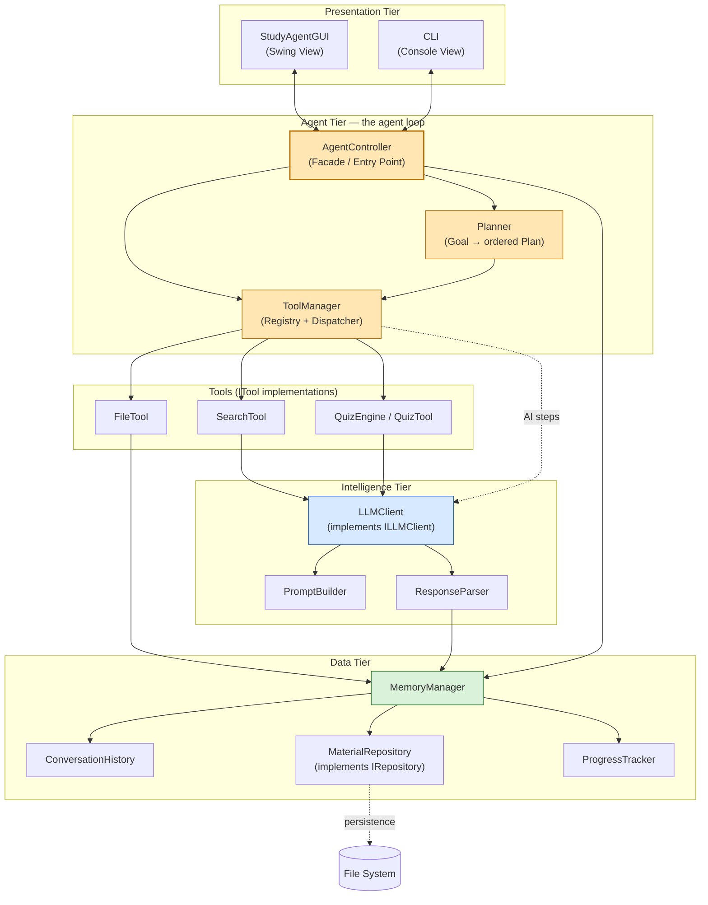
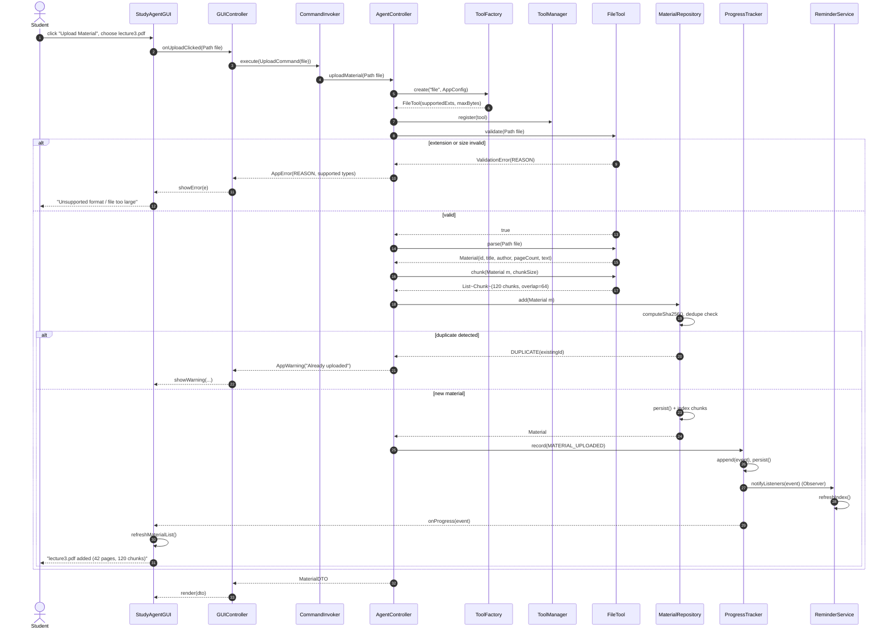
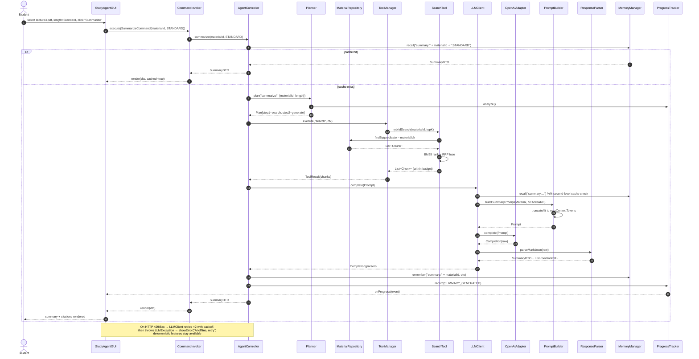
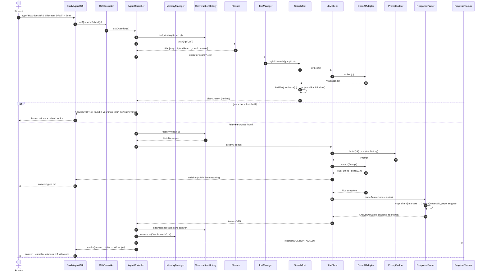
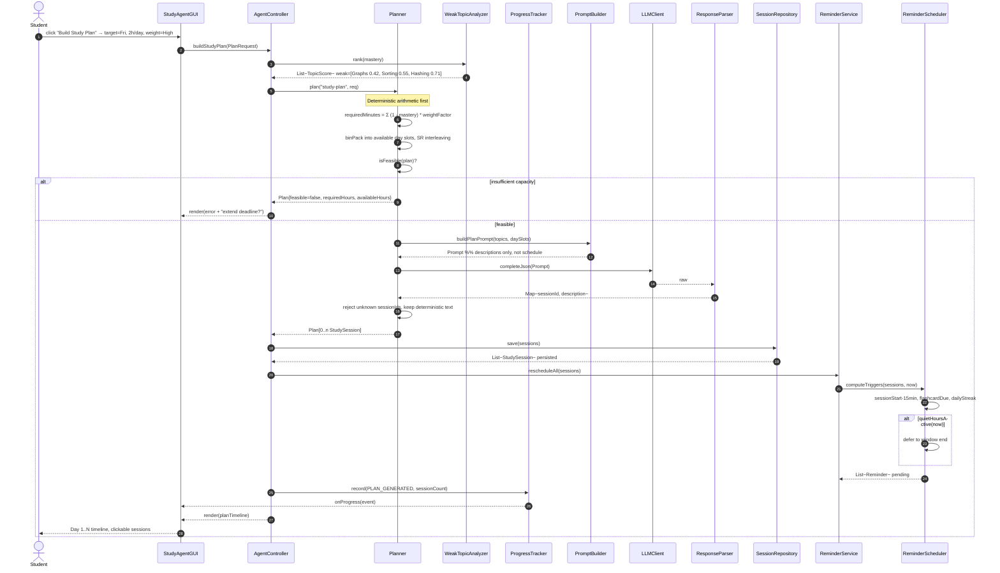
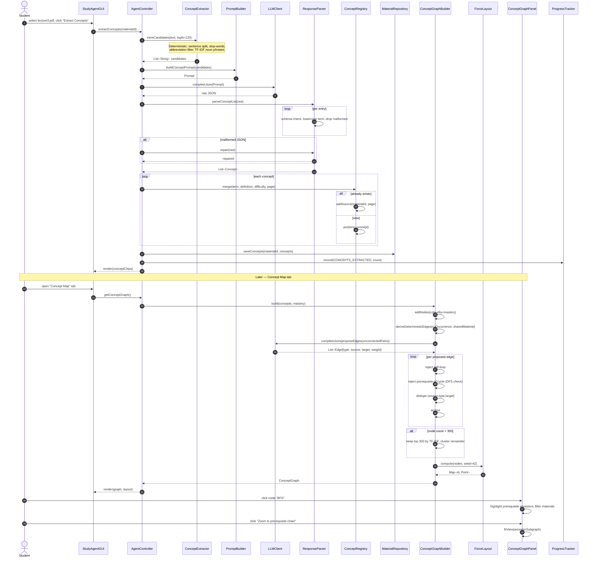
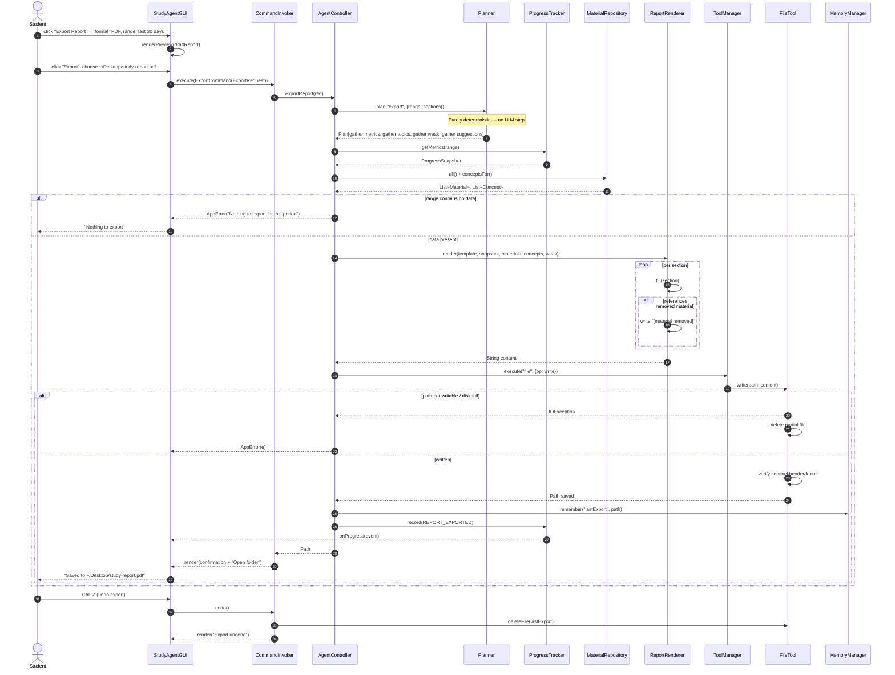

# EECS 3311 — Stage 1 Report
## StudyMate: An Autonomous Study Agent for Course Materials

**Stage:** 1 (Requirements & Design)
**Date:** 2026-09-30
**Team members:** Aaditya Tyagi
**Language / Platform:** Java 21, Swing GUI, Maven, JUnit 5

---

## 2.1 Project Overview

### Problem — Who are the users, and what problem do they face?

**Target users:** University students (first- and second-year, plus exam-revising
graduate students) who accumulate large volumes of unstructured course material —
lecture slides, textbook chapters, problem sets, past papers, and their own class
notes — and who must *learn* rather than merely *store* that material before
midterms and finals.

These users face four concrete problems:

1. **Volume and fragmentation.** A single course can span 200+ pages of slides,
   10 PDFs, and a shared drive of past papers. Material is scattered across
   file systems and note apps, so students cannot search across it all.
2. **No personalisation.** Generic summarisation tools (browser summaries,
   generic chatbot prompts) produce the same generic output for a student who
   is struggling with recursion and a student who has already mastered it. The
   student has no way to say *"focus here, I don't need that."*
3. **Passive consumption.** Reading a summary feels like studying but is not.
   Students need *active* practice — retrieval practice, quizzes, flashcards —
   and the tools that generate them are separate, manual, and time-consuming.
4. **No feedback loop.** When a student takes a practice quiz, nothing
   connects that result back to *what to study next*. Self-directed study is
   therefore blind: the student cannot identify weak topics systematically, so
   revision time is allocated by habit rather than by evidence.

The core problem statement is therefore:

> *How can a student turn an arbitrary pile of course material into a
> personalised, adaptive, evidence-driven study plan — and stay on it — without
> doing the clerical work of organising, summarising, quizzing and tracking
> themselves?*

### Why an agent? (and not just a chatbot)

A plain chatbot is a **request → response** function: the user asks one question,
gets one answer, and the interaction ends. It cannot hold a goal across a
session, it cannot take actions in the outside world, and it has no memory of
what the user has already studied.

An **agent** is a goal-directed loop. The difference is architectural and is
what makes it the right shape for this problem:

| Capability | Chatbot | StudyMate (agent) |
|---|---|---|
| Initiative | Reactive — waits for a prompt | Proactive — Planner derives next steps and can suggest actions the user did not ask for ("You're 40% below target on recursion — want a drill?") |
| Action taking | Produces text only | Executes **tools** that touch the real system: reads files, writes material, searches the store, generates and grades quizzes |
| Goal decomposition | Whole request in one shot | Breaks a vague goal ("prepare for the midterm") into an ordered **plan** of concrete steps, then executes step-by-step |
| Memory | Conversation buffer, forgotten on exit | Short-term **ConversationHistory** + long-term **MaterialRepository** + **ProgressTracker** state that persists across weeks |
| Adaptation | Fixed behaviour | Measures outcomes (quiz scores), updates the learner's model, and changes subsequent difficulty, plan and reminders |
| Recoverable failure | Fails the whole answer | Fails one step, records the error, and the Planner retries or routes around it |

Concretely, the agent earns its keep in four places in this design:

- **Tool use (F01, F04, F15).** Only an agent can call `FileTool.parse()` on a
  real PDF and `SearchTool` across the material store. A chatbot hallucinating a
  summary of a file it cannot read is worse than useless for studying.
- **Planning (F05, F09, F10).** "Prepare for the midterm" is not a one-call
  request. The `Planner` must decide: which topics, which order, which
  difficulty, how much time.
- **Memory + retrieval (F04, F14).** Answers must be grounded in *this
  student's* materials and *this student's* prior sessions.
- **A closed feedback loop (F08 → F09 → F10).** Grading produces data, the data
  identifies weak topics, weak topics drive the next plan and difficulty. This
  loop is the whole product, and it is agent-shaped by definition.

### Agent description

> **StudyMate** is a goal-directed study agent that turns a student's raw course
> material into an adaptive study programme. The student uploads PDFs, slides and
> notes; a `Planner` decomposes the student's goal ("master weak topics before
> Friday's midterm") into an ordered plan of tasks; a `ToolManager` dispatches
> each task to a concrete tool — a `FileTool` that parses documents, a
> `SearchTool` that retrieves grounded context from the material store, a
> `QuizEngine` that generates and grades practice questions. An `LLMClient`
> (built with `PromptBuilder` for prompt construction and `ResponseParser` for
> structured output) supplies the language reasoning. A `MemoryManager` retains
> `ConversationHistory`, long-term material facts and progress metrics, so the
> agent remembers across sessions. The `AgentController` exposes the whole thing
> through two interchangeable front ends — a Swing `StudyAgentGUI` and a `CLI` —
> and notifies observers (`ProgressTracker` views, `ReminderService`) as work
> completes. The system is deterministic where correctness is objective
> (parsing, grading, progress maths, persistence) and AI where judgement is
> required (summarising, question generation, explanation), with every AI call
> funneled through a single swappable `ILLMClient`.

### LLM choice

**OpenAI GPT-4o via API**, accessed through an `LLMAdapter` that implements
`ILLMClient`.

*Rationale:* strong instruction-following and JSON-schema compliance (needed by
`ResponseParser`), large context window for whole-chapter material, and a
`gpt-4o-mini` fallback configuration for cost. The `ILLMClient` interface plus
`LLMAdapter` means switching to **Ollama llama3.1 locally** is a one-class
change with no impact on any other subsystem — an OLLAMA adapter can be added
for offline/air-gapped use without touching `Planner`, `ToolManager` or the GUI.

### Overall architecture

The system follows a **layered, agent-loop architecture** with four tiers. The
**presentation tier** (`StudyAgentGUI` Swing app and `CLI`) contains no business
logic; both are thin views that translate user actions into controller calls and
render returned results. The **agent tier** is the heart: `AgentController`
acts as a Facade and entry point, `Planner` decomposes goals into an ordered
plan of steps, and `ToolManager` is a registry + dispatcher that maps each step
to the right `ITool` implementation via a `ToolFactory`. The **intelligence
tier** (`LLMClient`/`ILLMClient` + `PromptBuilder` + `ResponseParser`) wraps the
model so that prompts and structured outputs are built and validated in one
place. The **data tier** (`MemoryManager`, `ConversationHistory`,
`MaterialRepository`/`IRepository`) persists materials, conversation turns and
progress metrics. The loop is: *receive goal → plan → for each step dispatch a
tool (tools may call the LLM) → parse response → persist to memory → notify
observers → render in GUI/CLI*.



**Design decisions worth flagging:**

- The **Facade** (`AgentController`) is what keeps the two front ends from
  duplicating logic, and what keeps the GUI from knowing that summarising an
  uploaded PDF is a four-step chain.
- **No AI in the deterministic path.** Grading, progress maths, scheduling and
  persistence never call the LLM. This keeps results reproducible, testable and
  free, and it means an API outage degrades the product rather than breaking it.
- **The LLM is a tool, not an oracle.** Model calls sit behind `ILLMClient` and
  are invoked *by* tools, so the Planner decides *whether* reasoning is needed
  for a given step.

---

## 2.2 Feature Specification

All 15 features, each with the eight fields required by the assignment
specification. The **Type** column classifies each feature as
**AI** (requires model reasoning), **Deterministic** (pure computation — no model
call, fully unit-testable), or **Hybrid** (deterministic core with an AI layer).

| ID | Name | Description | User Interaction (GUI) | Input | Output | AI / Deterministic / Hybrid | Workflow | Error Cases |
|---|---|---|---|---|---|---|---|---|
| **F01** | Upload Learning Material | Student imports a document into the study library. Format is validated, text extracted, chunked and indexed for retrieval. | "Upload Material" button opens a file chooser; uploaded items appear in the Material Library list with title, size and page count. Selected item can be removed. | Local file: `.pdf`, `.txt`, `.md`, `.pptx` (max 25 MB) | Parsed `Material` record (id, title, author, pageCount, chunk list) persisted via `IRepository`; confirmation toast | **Deterministic** | `StudyAgentGUI.onUpload()` → `AgentController.uploadMaterial()` → `FileTool.validate()` → `FileTool.parse()` → `FileTool.chunk()` → `MaterialRepository.save()` → Observer event → refresh list | Unsupported/empty extension; file > 25 MB; corrupt or encrypted PDF (parser throws); unreadable path / permission denied; disk write failure; duplicate upload (hash match → warn, offer skip) |
| **F02** | Document Summarization | Produces a length-selectable (brief / standard / detailed) extractive-then-abstractive summary of a selected material. | "Summarize" action on a selected material; summary length dropdown; rendered in a Summary tab with Copy and Save buttons. | Selected `Material` id; target length; optional focus hint from user | Summary text plus a per-section `List<SectionRef>` citing source page numbers | **AI** | `StudyAgentGUI.onSummarize()` → `AgentController.summarize()` → `Planner.plan("summarize", materialId)` → `SearchTool.retrieveChunks()` → `LLMClient.complete()` with `PromptBuilder.buildSummaryPrompt()` → `ResponseParser.parseMarkdown()` → cache in `MemoryManager` → render | No material selected; material has no extractable text (scanned image) → "OCR unavailable"; LLM timeout/rate-limit → retry ×2 then error banner; context exceeds token budget → chunked map-reduce summarisation; user cancels mid-generation |
| **F03** | Concept Extraction | Identifies key technical concepts, definitions and prerequisites from a material, and links each concept to its source location. | "Extract Concepts" action; results shown as a tag cloud / chip list; each chip is clickable to show definition + page reference. | Selected `Material` id | `List<Concept>` (term, definition, difficulty, sourcePage, relatedTerms) persisted and used by F13 | **Hybrid** — deterministic NLP pre-pass (sentence segmentation, stop-word + abbreviation filter, TF-IDF noun-phrase candidate mining) feeds an LLM step that normalises, dedupes and defines the candidates | `StudyAgentGUI.onExtractConcepts()` → `AgentController.extractConcepts()` → `ConceptExtractor` deterministic pass → `PromptBuilder.buildConceptPrompt()` → `LLMClient.completeJson()` → `ResponseParser.parseConceptList()` → `MaterialRepository.saveConcepts()` → notify observers | Fewer than N noun phrases found → warn "material may be non-technical"; LLM returns malformed JSON → `ResponseParser` retries with a repair prompt, then fails gracefully; concept count exceeds cap → truncate by TF-IDF rank; duplicate terms across materials → merged by `ConceptRegistry` |
| **F04** | Q&A over Materials | Grounded question answering across all uploaded material, with citations to source documents and pages. Answers refuse rather than speculate when the material does not contain the answer. | Chat panel in the main window; streaming answer with inline citation chips; suggested-follow-up questions listed beneath each answer. | Free-text question; optional filter to a subset of materials | Grounded answer text + `List<Citation>` (materialId, page, snippet, relevance score) + follow-up suggestions | **AI + retrieval (RAG)** | `StudyAgentGUI.onAskQuestion()` → `AgentController.askQuestion()` → `Planner.plan("qa", question)` → `SearchTool.hybridSearch()` (BM25 + dense, RRF fusion) over `MaterialRepository` → top-k chunks → `LLMClient.stream()` with retrieved context + `ConversationHistory` window → `ResponseParser.parseAnswer()` → citations rendered | Question empty; no materials uploaded → prompt to upload; no chunk above relevance threshold → "Not found in your materials" (no hallucination); LLM failure → error state with retry; question in an unsupported language → polite redirect; context too large → iterative map-reduce retrieval |
| **F05** | Personalized Study Plan | Generates a day-by-day study schedule from a target date/exam, the student's stated availability, and identified weak topics, then adapts when the plan is missed. | "Build Study Plan" button opens a dialog (target date, hours/day, weak-topic weighting slider); plan renders as a Gantt-style timeline of sessions per day; sessions are clickable and startable. | Target date; available hours per day; weak topics from F09; per-topic confidence scores | `List<StudySession>` (day, topic, taskType, plannedMinutes, priority) persisted to the session history | **AI + planner (Hybrid)** | `StudyAgentGUI.onBuildPlan()` → `AgentController.buildStudyPlan()` → `Planner` (deterministic scheduling: bin-pack sessions into available day slots) → gap analysis via `ProgressTracker.getWeakTopics()` → `PromptBuilder.buildPlanPrompt()` → `LLMClient.completeJson()` for topic ordering and task descriptions → `StudySessionRepository.save()` → notify `ReminderService` | Target date in the past; available hours = 0 → "insufficient capacity" error listing required vs available hours; no material/topic profile yet → fall back to generic syllabus template; plan overflows available time → `Planner` re-balances and warns which topics were dropped; user has already exceeded target for a topic → topic de-prioritised |
| **F06** | Flashcard Generation | Produces atomic question/answer flashcards from selected materials or concepts, in both recall and cloze-deletion styles, tagged by topic. | "Generate Flashcards" action; flashcards display in a flip-card widget with Next / Previous / Shuffle; "Known" and "Review" buttons feed spaced repetition scheduling. | Material or concept selection; card count; card style (recall / cloze) | `List<Flashcard>` (front, back, topic, style) + review state and next-due date per card | **AI** | `StudyAgentGUI.onGenerateFlashcards()` → `AgentController.generateFlashcards()` → `SearchTool.retrieveChunks()` per target concept → `PromptBuilder.buildFlashcardPrompt()` (enforces one-fact-per-card) → `LLMClient.completeJson()` → `ResponseParser.parseFlashcards()` → `FlashcardRepository.save()` → `MemoryManager` updates review schedule | Empty source selection; LLM returns an over-long or multi-fact card → validator rejects and re-prompts; duplicate card detected (Jaccard > 0.9) → dropped with count reported; card count exceeds cap → truncated; user attempts to generate with zero materials |
| **F07** | Quiz Generation | Builds a timed practice quiz — multiple choice, short answer and true/false — from materials or weak topics, at a difficulty chosen automatically or by the user. | "Generate Quiz" action opens a setup dialog (topic scope, question count, difficulty, timed/on/off); quiz renders one question at a time with a progress bar and timer. | Topic scope; question count (1–50); difficulty level; time limit | `List<Question>` (type, prompt, options, correctAnswer, topic, difficulty, rationale) + `Quiz` metadata; attempt recorded | **AI** | `StudyAgentGUI.onGenerateQuiz()` → `AgentController.generateQuiz()` → `Planner.plan("quiz", scope, difficulty)` → `SearchTool.retrieveChunks()` + `Concept` list → `PromptBuilder.buildQuizPrompt()` with JSON schema → `LLMClient.completeJson()` → `ResponseParser.parseQuiz()` (validates option counts, strips answer leakage) → `QuizEngine.registerQuiz()` → GUI renders | Invalid question count or negative time limit → validation error; LLM returns inconsistent MCQ (no correct option, duplicate options) → `ResponseParser` repair retry, then drop the item; insufficient source material for requested count → generate fewer and inform the user; quiz requested on a topic with no concepts |
| **F08** | Auto Quiz Grading | Grades a completed quiz attempt. Objective question types are graded deterministically with exact/normalized match; free-text answers are graded by the LLM against a rubric and flagged for student review. | "Submit Quiz" button; results screen shows per-question breakdown with correct/incorrect, the correct answer, and an explanation; overall score and per-topic breakdown displayed. | Completed `QuizAttempt` (questionId → user answer) | `GradeResult` (per-question correctness, per-topic score map, total percentage, explanations) persisted; feeds F09/F10/F11 | **Deterministic (exact + normalized match) + AI (open-ended answers only)** | `StudyAgentGUI.onSubmitQuiz()` → `AgentController.gradeQuiz()` → `QuizEngine.grade()` — MCQ/TF via `AnswerNormalizer.exactMatch()`; short answer via normalized string + Levenshtein ratio ≥ 0.85; free response via `LLMClient` rubric prompt → `ResponseParser.parseGrade()` → `ProgressTracker.recordAttempt()` → `WeakTopicAnalyzer.analyze()` → notify observers → render results | Unanswered questions → marked incorrect, zero points (not an error); malformed answer object (missing questionId) → validation error listing bad ids; ambiguous free-text grade with low model confidence → flagged "needs review" and excluded from weak-topic maths; network failure during open-ended grading → graded on objective items only, rest deferred with a banner |
| **F09** | Weak Topic Identification | Aggregates quiz scores, flashcard review outcomes and study-session completion into a per-topic mastery score, and asks the LLM to explain *why* each weak topic is weak and what to do about it. | "My Progress" tab shows a mastery bar chart by topic with red/amber/green bands; clicking a weak topic shows the AI diagnosis and a "Study this now" button that jumps to F05. | `ProgressTracker` metrics history; recent attempts; per-topic scores | `Map<Topic, MasteryScore>` (score 0–1, trend, attemptCount) + `List<Diagnosis>` (topic, cause, recommended actions) | **Deterministic analytics + AI explanation (Hybrid)** | `StudyAgentGUI.onViewProgress()` → `AgentController.getWeakTopics()` → `ProgressTracker.getMetrics()` → `WeakTopicAnalyzer.compute()` (exponential moving average + confidence interval, minimum-attempt threshold) → `PromptBuilder.buildDiagnosisPrompt()` → `LLMClient.completeJson()` → `ProgressTracker.updateMastery()` → notify observers → render chart | Fewer than the minimum attempts for a topic → shown as "insufficient data", excluded from ranking; no attempts recorded at all → empty-state guidance to take a diagnostic quiz; contradictory trend (high EMA, low raw score) → lower confidence, show both values; LLM failure → chart still renders with deterministic diagnosis (lowest-scoring topics) |
| **F10** | Adaptive Difficulty | Adjusts the difficulty of subsequently generated quizzes and flashcards to hold the learner near a target success band (roughly 60–80%), using recent performance as the signal. | Difficulty shown as an "Adaptive" toggle in the quiz setup dialog, with the currently inferred level (Foundation / Developing / Proficient / Advanced) displayed; users may pin a level to override. | Recent per-topic mastery scores; question difficulty labels; user override flag | Updated `DifficultyProfile` (per-topic level, direction of adjustment) applied to future `PromptBuilder` calls | **Hybrid — rule-based adjustment + LLM calibration** | Deterministic `AdaptiveDifficultyController.step()`: compute per-topic success rate over a sliding window; if < 0.6 for 2 consecutive quizzes → lower level; if > 0.8 → raise level; bounds ±1 step per adjustment, clamped to 1–4 → `PromptBuilder.buildQuizPrompt(difficulty)` and `buildFlashcardPrompt(difficulty)` consume the level → result recorded in `ProgressTracker` | Window too small (< 3 responses) → no adjustment, level held; contradictory signal (oscillating scores) → hysteresis prevents flapping, adjustments damped; explicit user override → automation disabled for that topic, surfaced as "pinned"; all topics at max/min level → clamps and reports saturation |
| **F11** | Progress Tracking | Records every study event — material uploads, sessions completed, quizzes taken, flashcards reviewed — into a persistent per-topic metric history and renders trends over time. | "My Progress" tab with a line chart of mastery over time, totals (hours studied, quizzes taken, average score), and a per-event activity log. | Study events emitted by other features; date range filter | Persisted `List<ProgressEvent>` + computed metrics (total study time, per-topic mastery history, streaks) | **Deterministic** | Every subsystem emits a `ProgressEvent` → `ProgressTracker.record()` (singleton) → appends to in-memory index and persists via `IRepository` → `notifyObservers()` → `StudyAgentGUI` refreshes charts (Observer) and `ReminderService` re-evaluates | Corrupt or partially-written progress file on load → backed up and rebuilt from event log; duplicate event id (replay) → de-duplicated by id; clock moved backwards → timestamps normalised, anomaly logged; metrics recomputation over > 10,000 events → run on a background thread with progress indicator |
| **F12** | Study Reminders | Schedules reminders for planned sessions, spaced-repetition flashcard reviews and streak-protection nudges, and delivers them as desktop notifications. | Reminders panel listing upcoming reminders with snooze/disable controls; a "quiet hours" window setting; a reminder popup with "Start now" action. | Study plan (F05), flashcard due dates (F06), streak state (F11), quiet-hours preferences | `List<Reminder>` (id, triggerTime, type, payload) scheduled by `ReminderService`; desktop notifications fired at trigger time | **Deterministic (Observer + scheduler)** | `Planner` publishes plan → `ReminderService.attach()` as an observer of `ProgressTracker` → `ReminderScheduler` computes trigger times (session start minus 15 min; flashcard due date; daily streak check) → on fire, posts a `DesktopNotification` → optional deep-link launches the session in the GUI | OS notification permission denied → falls back to in-app banner; reminder fires while app is closed → queued and shown on next launch; system clock/timezone change → all pending reminders recomputed against new time; user in quiet hours → deferred to the end of the window rather than dropped; duplicate reminder id → coalesced |
| **F13** | Concept Relationship Graph | Builds a graph of concepts and their relationships (prerequisite-of, related-to, contrasts-with, part-of) drawn from extracted concepts, and lets the student navigate the topic space. | "Concept Map" tab rendering a force-directed graph; nodes coloured by mastery; clicking a node filters materials and highlights prerequisites; "Zoom to prerequisite chain" action. | `List<Concept>` from F03; per-topic mastery from F09; relationship assertions from `LLMClient` | `ConceptGraph` (nodes = concepts, edges = typed relationships with weights) plus a rendered `BufferedImage`/Swing component | **Hybrid** — deterministic layout and graph storage, LLM-suggested edges | `StudyAgentGUI.onOpenConceptMap()` → `AgentController.getConceptGraph()` → `ConceptGraphBuilder` builds node set deterministically → `LLMClient.completeJson()` proposes typed edges for unconnected node pairs → `ConceptGraph.addEdge()` dedupes and validates (no self-loops, no cycles in `prerequisite-of`) → `ForceLayout.compute()` → `ConceptGraphPanel.paint()` | Graph exceeds the node cap (e.g. > 300) → top-N by TF-IDF rank shown, remainder collapsed into a cluster node; LLM proposes a self-loop or `prerequisite-of` cycle → edge rejected and logged; no concepts extracted yet → empty state prompting F03; layout computation too slow → incremental layout with a "computing…" indicator |
| **F14** | Learning Session History | Keeps a searchable, persistent log of every session: what was studied, which materials and cards were touched, quiz outcomes, and free-text notes the student wrote. | "History" tab with a reverse-chronological session list, filter by date/topic/material, session detail view, and a student notes field per session. | Session start/end events; material and card interactions; quiz outcomes; user notes | `List<StudySessionRecord>` with `List<SessionActivity>`; searchable index; per-session summary | **Deterministic** | Session opened → `MemoryManager` starts a `StudySession`; each action appends a `SessionActivity` → `SessionRepository.save()` on completion and every N seconds → `StudyAgentGUI` refreshes on Observer event → "Continue last session" restores context on launch | Session left open across app restart → recovered as an interrupted session on next launch; activity log write failure → buffered in memory and retried; a session with no activities → hidden by default (toggleable); corrupted history file → previous snapshot restored, with a warning banner |
| **F15** | Export Study Report | Produces a shareable study report (Markdown / PDF) covering progress, mastery per topic, weak areas, and the recommended next steps. | "Export Report" button opens a save dialog with format (Markdown/PDF) and section checkboxes; a preview pane shows the report before saving. | Date range; selected sections; `ProgressTracker` metrics; `Concept` set; study plan | File written to disk (`.md` or `.pdf`) via `FileTool.write()`; confirmation with the saved path and option to open the containing folder | **Deterministic (template rendering; no LLM)** | `StudyAgentGUI.onExportReport()` → `AgentController.exportReport()` → `Planner.plan("export", range, sections)` → deterministic data gathering from `ProgressTracker`/`MaterialRepository` → `ReportRenderer` (Velocity/FreeMarker template, or a hand-rolled `StringBuilder` writer) → `FileTool.write()` → confirmation dialog | Target path not writable / permission denied → error with a suggestion to choose another location; no data in the selected range → "nothing to export" rather than an empty file; unknown extension → forced to `.md`; disk full → exception surfaced, partial file removed; a report section references a deleted material → rendered as "[material removed]" |
| **F16** | Configuration & LLM Provider Settings | Lets the user choose the LLM provider and model, set API credentials, and configure retrieval and generation parameters. | Settings dialog (provider dropdown: OpenAI / Ollama, model field, API key field stored in the OS keychain, temperature, top-k retrieval count, chunk size). | Provider choice; model id; API key; `RetrievalConfig` parameters | Persisted `AppConfig`; `LLMAdapter` re-bound to the selected provider at runtime without restart | **Hybrid** — deterministic config persistence and validation, Adapter-based provider swapping | `StudyAgentGUI.onOpenSettings()` → `AgentController.updateConfig()` → `ConfigValidator` (checks key presence, model id format, numeric bounds) → `AppConfig` persisted → `LLMAdapterFactory.create(config)` returns the matching `ILLMClient` → existing `LLMClient` reference swapped → Observer notifies open sessions | Missing/invalid API key → provider-specific error, save blocked; unreachable Ollama host → connection test on save, warning shown but config kept; temperature or top-k out of range → clamped with a notice; config file unreadable → defaults loaded, backup written; swap fails at runtime → previous provider retained, error surfaced |

**Feature count: 16** (15 functional features F01–F15, plus F16 configuration
supporting the AI features).

### Feature type distribution

| Type | Features | Count |
|---|---|---|
| AI | F02, F04, F06, F07 | 4 |
| Deterministic | F01, F08 (objective path), F11, F12, F14, F15 | 6 |
| Hybrid | F03, F05, F08 (open-ended path), F09, F10, F13, F16 | 7 |

Roughly 60% of features are deterministic or deterministic-core, which is the
intended design posture: model calls are spent on judgement work, not on work
that `String.equals` can do.

## 2.3 UML Class Diagram

Rendered with Mermaid (`classDiagram`), which is the tool used throughout this
report. PlantUML source for the same diagram is provided in
`stage1/diagrams/ClassDiagram.puml` so it can be rendered to PNG/PDF if the
submission requires an image.

```mermaid
classDiagram
direction LR

    %% ============ INTERFACES ============
    class ITool {
        <<interface>>
        +String getName()
        +String getDescription()
        +ParameterSchema getParameters()
        +ToolResult execute(ToolContext ctx, Map params)
        +boolean validate(Map params)
        +int getCostEstimate()
    }

    class ILLMClient {
        <<interface>>
        +Completion complete(Prompt prompt)
        +Flux~String~ stream(Prompt prompt)
        +Embedding embed(String text)
        +String getModelId()
        +boolean isAvailable()
    }

    class IRepository~T~ {
        <<interface>>
        +T save(T entity)
        +Optional~T~ findById(String id)
        +List~T~ findAll()
        +List~T~ findBy(Predicate p)
        +boolean delete(String id)
        +void replaceAll(List~T~ items)
    }

    class ProgressListener {
        <<interface>>
        +void onProgress(ProgressEvent event)
        +void onStateChanged(AppState state)
    }

    class Command {
        <<interface>>
        +String getName()
        +CommandResult execute()
        +void undo()
        +boolean isUndoable()
    }

    class View {
        <<interface>>
        +void render(Result r)
        +void showError(AppError e)
        +void showProgress(String msg, int pct)
    }

    %% ============ PRESENTATION ============
    class StudyAgentGUI {
        -JFrame frame
        -MaterialListPanel materialPanel
        -ChatPanel chatPanel
        -ProgressChartPanel progressPanel
        -ConceptGraphPanel graphPanel
        -List~View~ views
        +void onUpload()
        +void onSummarize()
        +void onAskQuestion()
        +void onGenerateQuiz()
        +void onSubmitQuiz()
        +void onBuildStudyPlan()
        +void onViewProgress()
        +void onExportReport()
        +void onOpenSettings()
        +void main(String[] args)
    }

    class CLI {
        -Scanner in
        -AgentController controller
        +void start()
        +void registerCommands()
        +void printHelp()
    }

    class GUIController {
        -StudyAgentGUI gui
        -AgentController controller
        +void attach()
        +void onUploadClicked()
        +void onQuestionSubmit(String q)
    }

    %% ============ AGENT CORE ============
    class AgentController {
        -Planner planner
        -ToolManager toolManager
        -MemoryManager memory
        -LLMClient llmClient
        -CommandInvoker invoker
        -ProgressTracker progressTracker
        -AppConfig config
        +Result handleIntent(String userInput)
        +MaterialDTO uploadMaterial(Path file)
        +SummaryDTO summarize(String materialId, SummaryLength len)
        +List~Concept~ extractConcepts(String materialId)
        +AnswerDTO askQuestion(String question)
        +StudyPlan buildStudyPlan(PlanRequest req)
        +List~Flashcard~ generateFlashcards(FlashcardRequest req)
        +Quiz generateQuiz(QuizRequest req)
        +GradeResult gradeQuiz(QuizAttempt attempt)
        +WeakTopicReport getWeakTopics()
        +void updateDifficulty(String topic, boolean automatic)
        +ProgressSnapshot getProgress(DateRange r)
        +List~Reminder~ getReminders()
        +ConceptGraph getConceptGraph()
        +List~SessionRecord~ getHistory(HistoryFilter f)
        +Path exportReport(ExportRequest req)
        +void updateConfig(AppConfig cfg)
        +void shutdown()
    }

    class Planner {
        -MemoryManager memory
        -ToolManager toolManager
        -WeakTopicAnalyzer analyzer
        +Plan plan(String intent, Map args)
        +List~PlanStep~ decompose(Goal goal)
        +void reorderByPriority(Plan plan)
        +boolean isFeasible(Plan plan)
    }

    class PlanStep {
        +String stepId
        +String toolName
        +Map~String,Object~ params
        +int priority
        +StepStatus status
        +String error
    }

    class ToolManager {
        -Map~String,ITool~ registry
        -ToolFactory factory
        -Map~String,Integer~ callCounts
        +void register(ITool tool)
        +ToolResult execute(String toolName, ToolContext ctx)
        +List~String~ listTools()
        +ITool resolve(String capability)
    }

    class ToolFactory {
        +ITool create(String type, Map config)
        +FileTool createFileTool()
        +SearchTool createSearchTool()
        +QuizTool createQuizTool()
    }

    class FileTool {
        -List~String~ supportedExts
        -long maxBytes
        +Material parse(Path file)
        +List~Chunk~ chunk(Material m, int size)
        +void write(String path, String content)
        +boolean validate(Path file)
    }

    class SearchTool {
        -IRepository~Chunk~ repo
        -ILLMClient llm
        -BM25Index lexical
        +List~Chunk~ hybridSearch(String q, int k)
        +List~String~ reciprocalRankFusion(List~List~Chunk~~ ranked)
        +double score(Chunk c, String q)
    }

    class QuizTool {
        -QuizEngine engine
        -AdaptiveDifficultyController difficulty
        +List~Question~ generate(QuizRequest req)
        +Prompt buildPrompt(QuizRequest req)
    }

    %% ============ INTELLIGENCE ============
    class LLMClient {
        -static LLMClient instance$
        -ILLMClient adapter
        -PromptBuilder promptBuilder
        -ResponseParser parser
        -int maxRetries
        -double temperature
        +static LLMClient getInstance()
        +Completion complete(Prompt p)
        +Flux~String~ stream(Prompt p)
        +void setAdapter(ILLMClient a)
        +boolean isHealthy()
    }

    class OpenAIAdapter {
        -String apiKey
        -String baseUrl
        +Completion complete(Prompt p)
        +Flux~String~ stream(Prompt p)
        +Embedding embed(String t)
    }

    class OllamaAdapter {
        -String host
        -String model
        +Completion complete(Prompt p)
        +Flux~String~ stream(Prompt p)
    }

    class PromptBuilder {
        -String systemRole
        -PromptTemplate template
        -int maxContextTokens
        +Prompt buildSummaryPrompt(Material m, SummaryLength l)
        +Prompt buildConceptPrompt(List~String~ candidates)
        +Prompt buildQA(String question, List~Chunk~ ctx)
        +Prompt buildQuizPrompt(QuizRequest r, int difficulty)
        +Prompt buildFlashcardPrompt(Concept c, int count)
        +Prompt buildDiagnosisPrompt(List~TopicScore~ weak)
        +Prompt buildRubricPrompt(Question q, String answer)
    }

    class ResponseParser {
        -JsonSchema schema
        +Completion parseCompletion(String raw)
        +List~Concept~ parseConceptList(String json)
        +Quiz parseQuiz(String json)
        +List~Flashcard~ parseFlashcards(String json)
        +AnswerDTO parseAnswer(String raw, List~Chunk~ src)
        +GradeResult parseGrade(String json)
        +String repair(String malformed)
    }

    %% ============ MEMORY / DATA ============
    class MemoryManager {
        -static MemoryManager instance$
        -ConversationHistory history
        -IRepository~Material~ materials
        -IRepository~ProgressEvent~ events
        -IRepository~Flashcard~ cards
        -Cache~String,String~ llmCache
        -MemoryType type
        +static MemoryManager getInstance()
        +void remember(String key, String value)
        +String recall(String key)
        +void persistAll()
        +void loadAll()
    }

    class ConversationHistory {
        -List~Message~ messages
        -int maxTokens
        +void add(Message m)
        +List~Message~ recentWindow(int n)
        +String compress()
    }

    class MaterialRepository {
        -IRepository~Material~ delegate
        -Map~String,List~Concept~~ conceptIndex
        +Material add(Material m)
        +Optional~Material~ get(String id)
        +List~Material~ all()
        +boolean remove(String id)
        +List~Concept~ conceptsFor(String materialId)
    }

    class QuizEngine {
        -Map~String,Quiz~ quizzes
        -AnswerNormalizer normalizer
        +Quiz register(Quiz q)
        +GradeResult grade(QuizAttempt a)
        +double exactMatch(String expected, String actual)
        +double levenshteinRatio(String a, String b)
    }

    class ProgressTracker {
        -List~ProgressEvent~ events
        -Map~String,Double~ mastery
        -List~ProgressListener~ listeners
        -WeakTopicAnalyzer analyzer
        +void record(ProgressEvent e)
        +void attach(ProgressListener l)
        +void detach(ProgressListener l)
        +void notifyListeners(ProgressEvent e)
        +WeakTopicReport analyze()
        +double masteryOf(String topic)
    }

    class WeakTopicAnalyzer {
        -double minAttempts
        +Map~String,Double~ compute(List~ProgressEvent~ e)
        +double ema(List~Double~ scores, double alpha)
        +List~TopicScore~ rank(Map~String,Double~ m)
    }

    class AdaptiveDifficultyController {
        -Map~String,Integer~ levels
        -Map~String,Boolean~ pinned
        -Window window
        +int currentLevel(String topic)
        +void step(String topic, boolean wasCorrect)
        +int nextLevel(String topic)
    }

    class ReminderService {
        -ScheduledExecutorService scheduler
        -List~Reminder~ pending
        +void schedule(Reminder r)
        +void rescheduleAll(List~StudySession~ plan)
        +void snooze(String reminderId, Duration d)
        +void cancel(String reminderId)
    }

    class CommandInvoker {
        -Deque~Command~ history
        +void execute(Command c)
        +void undo()
        +void redo()
    }

    class SummarizeCommand {
        +execute()
        +undo()
    }
    class QuizCommand {
        +execute()
        +undo()
    }
    class ExportCommand {
        +execute()
        +undo()
    }

    %% ============ RELATIONSHIPS ============
    AgentController --> Planner : uses (1)
    AgentController --> ToolManager : uses (1)
    AgentController --> MemoryManager : uses (1)
    AgentController --> LLMClient : uses (1)
    AgentController --> CommandInvoker : uses (1)
    AgentController o-- ProgressTracker : 1..1
    AgentController ..> AppConfig : dependency

    StudyAgentGUI ..|> View
    StudyAgentGUI --> GUIController : composition 1
    GUIController --> AgentController : calls
    CLI ..|> View
    CLI --> AgentController : calls
    CLI --> CommandInvoker : calls

    Planner --> MemoryManager : queries (1)
    Planner --> ToolManager : plans against
    Planner --> WeakTopicAnalyzer : uses
    Planner *-- "0..*" PlanStep

    ToolManager o-- "0..*" ITool : registry
    ToolManager --> ToolFactory : creates
    ITool <|.. FileTool
    ITool <|.. SearchTool
    ITool <|.. QuizTool
    FileTool ..> MaterialRepository : saves via
    SearchTool --> MaterialRepository : searches (1)
    SearchTool ..> ILLMClient : embeds via

    LLMClient ..|> ILLMClient
    LLMClient o-- PromptBuilder
    LLMClient o-- ResponseParser
    ILLMClient <|.. OpenAIAdapter
    ILLMClient <|.. OllamaAdapter
    LLMClient ..> OpenAIAdapter : delegates (1)

    MemoryManager o-- ConversationHistory
    MemoryManager ..> IRepository : persists
    MaterialRepository ..|> IRepository
    MemoryManager o-- MaterialRepository
    QuizEngine --> QuizTool
    QuizEngine ..> LLMClient : open-ended grading
    ProgressTracker --> WeakTopicAnalyzer
    ProgressTracker o-- "0..*" ProgressEvent
    ProgressTracker o-- "0..*" ProgressListener : notifies
    ReminderService ..|> ProgressListener
    StudyAgentGUI ..|> ProgressListener
    QuizTool --> AdaptiveDifficultyController
    Command <|.. SummarizeCommand
    Command <|.. QuizCommand
    Command <|.. ExportCommand
    CommandInvoker o-- "0..*" Command
```



### Relationship legend

| Relationship | Where it appears | Meaning |
|---|---|---|
| **Inheritance** (`<\|--`) | `ITool ← FileTool/SearchTool/QuizTool`; `ILLMClient ← LLMClient ← OpenAIAdapter/OllamaAdapter`; `IRepository ← MaterialRepository`; `View ← StudyAgentGUI/CLI`; `Command ← Summarize/Quiz/ExportCommand`; `ProgressListener ← ReminderService, StudyAgentGUI` | Substitutable polymorphism — every arrow is a substitutable type, never a "concrete class used as if different" |
| **Interface realisation** (`..\|>`) | `LLMClient ..\|> ILLMClient`; adapters | Contract-first design; the interface is the stable seam |
| **Aggregation** (`o--`) | `ToolManager o-- 0..* ITool`; `MemoryManager o-- ConversationHistory`; `AgentController o-- ProgressTracker`; `CommandInvoker o-- 0..* Command` | "has-a", parts can outlive/replace independently |
| **Composition** (`*--`) | `Planner *-- 0..* PlanStep`; `AgentController`–`PromptBuilder`/`ResponseParser`; `StudyAgentGUI`–panels | "part-of", lifetime bound to the whole; steps die with their plan |
| **Association** (`-->`) | `GUIController --> AgentController`; `ToolManager --> ToolFactory`; `QuizEngine --> QuizTool`; `Planner --> WeakTopicAnalyzer` | Uses another object's services, no ownership |
| **Dependency** (`..>`) | `SearchTool ..> ILLMClient`; `FileTool ..> MaterialRepository`; `StudyAgentGUI ..> AppConfig` | Temporary "uses at compile time only" — parameter types, locals |
| **Multiplicity** | `ToolManager o-- "0..*"`; `Planner *-- "0..*"`; `CommandInvoker o-- "0..*"` | 1 controller ↔ 0..n tools/steps/commands; each tool ↔ exactly 1 registry |

### The 8 design patterns visible in this diagram

| # | Pattern | Concrete location in the diagram |
|---|---|---|
| 1 | **Facade** | `AgentController` hides Planner + ToolManager + LLMClient + MemoryManager behind 14 simple methods |
| 2 | **Strategy** | `ITool` family — `FileTool` / `SearchTool` / `QuizTool` are interchangeable strategies selected at runtime by `ToolManager.resolve(capability)` |
| 3 | **Factory Method** | `ToolFactory.create(type, config)` produces the right `ITool` without `ToolManager` knowing concrete classes |
| 4 | **Observer** | `ProgressTracker` o-- `0..* ProgressListener`, implemented by `ReminderService` and `StudyAgentGUI` |
| 5 | **Command** | `Command` interface with `SummarizeCommand` / `QuizCommand` / `ExportCommand`, driven by `CommandInvoker` for undo/redo and shared by GUI + CLI |
| 6 | **Singleton** | `LLMClient.instance$` and `MemoryManager.instance$` static instances |
| 7 | **Adapter** | `OpenAIAdapter` / `OllamaAdapter` wrap two incompatible provider APIs behind `ILLMClient` |
| 8 | **MVC** | `View ← StudyAgentGUI / CLI` (view), `AgentController` (controller), `Material` / `ProgressEvent` / `Quiz` models owned by repositories |

## 2.4 Design Pattern Explanations

> **Pattern count: this design uses 8 design patterns from the course list,
> exceeding the required minimum of 5.**
> Facade, Strategy, Factory Method, Observer, Command, Adapter, Singleton, MVC.
> Every one appears in the class diagram (2.3) as a real structural relationship,
> not just as a naming convention, and every one is justified below.

Seven patterns are explained in full below, each answering the five questions the
specification requires: **what problem**, **which classes**, **roles**,
**why it is appropriate here**, and **what would be harder without it**. An
eighth (MVC) is summarised in a table at the end of the section. Singleton and
Adapter are also treated as a pair, since the same seam solves two problems.

---

### Pattern 1 — Facade: `AgentController`

**1. What problem does it solve?**
The agent loop spans five subsystems (Planner, ToolManager, LLMClient,
MemoryManager, ProgressTracker). A naive front end would have to orchestrate
all of them in the right order for every one of its 16 features. That produces
order-dependent duplication across `StudyAgentGUI` and `CLI`, and it means a
change to the plan-execution order has to be replicated in the GUI, the CLI and
any future front end.

**2. Which classes are involved?**
`AgentController` (facade) over `Planner`, `ToolManager`, `LLMClient`,
`MemoryManager`, `ProgressTracker`, `CommandInvoker`. Consumers:
`GUIController`, `CLI`.

**3. What are the roles?**
- *Facade* — `AgentController`: exposes one method per user-level intent
  (`summarize`, `askQuestion`, `gradeQuiz`, `exportReport`), each a small
  sequence over the subsystem APIs. Contains no algorithm of its own.
- *Subsystem classes* — `Planner`, `ToolManager`, `LLMClient`,
  `MemoryManager`, `ProgressTracker`: keep their own logic and remain usable
  directly by unit tests and by the CLI.
- *Client* — `GUIController` and `CLI`: know only the facade's 16 methods.

**4. Why is it appropriate here?**
The subsystem API is intentionally wide and the correct *order* is the real
domain knowledge — retrieval must precede generation; grading must precede
weak-topic analysis; grading must precede difficulty adjustment. That ordering
knowledge belongs in one place that both front ends inherit, not in two places
that can drift. It also gives the front ends a stable seam: adding a mobile or
web client in Stage 3 means implementing nothing but the facade's existing
contract. Facade is used instead of a single god-class because the subsystem
classes stay independently testable — `PlannerTest` never constructs a facade.

**5. What would be harder without it?**
`StudyAgentGUI.onSummarize()` would read roughly: *retrieve chunks → build
prompt → call LLM → parse → cache → render*. `CLI.summarize()` would read the
same six steps. Fixing the "retry twice on rate limit" rule would be a
three-site change. The most concrete loss: **the deterministic/AI split
decision** ("does this intent need a model call at all?") would be re-decided
independently in each front end, and the two would eventually disagree — the
CLI charging API calls for a grade the GUI graded for free.

---

### Pattern 2 — Strategy: `ITool` and its implementations

**1. What problem does it solve?**
Capabilities are heterogeneous and they change independently of each other.
Parsing a PDF, searching an index and generating a quiz share nothing but the
notion of "given parameters, do something and return a result". Without a
common abstraction, `ToolManager` grows a `switch` on tool type, a new
capability means editing the manager, and the manager cannot be tested without
stubbing all of them.

**2. Which classes are involved?**
`ITool` (strategy interface) implemented by `FileTool`, `SearchTool`,
`QuizTool`; selected by `ToolManager.resolve(capability)`, created by
`ToolFactory`, invoked by `Planner`.

**3. What are the roles?**
- *Strategy* — `ITool`: declares `execute(ToolContext, Map)` plus
  `getName()`, `getParameters()`, `validate()`, `getCostEstimate()`.
- *Concrete strategies* — `FileTool` (parse/chunk/write),
  `SearchTool` (hybrid BM25 + dense retrieval), `QuizTool` (question
  generation at a difficulty).
- *Context* — `ToolManager`: holds the strategy set in a `Map<String, ITool>`
  and delegates to the strategy chosen by name or capability.
- *Planner* — the client that picks a strategy per plan step by name.

**4. Why is it appropriate here?**
Strategy fits precisely because (a) the algorithms genuinely differ, (b) they
are selected at runtime from data — the `toolName` field in a `PlanStep`
produced by the `Planner`, not by a compile-time decision — and (c) they are
interchangeable through a common signature. The payoff is concrete:
`ToolManager` has a `Map`, not a `switch`, so adding a
`TranslateTool` in Stage 3 is one new class plus one registry line and touches
no existing code. The `getCostEstimate()` method exists because strategy
objects must be introspectable by the planner to budget API spend before
running a plan.

**5. What would be harder without it?**
`ToolManager` would need a `switch (toolName)` with a branch per capability
branching internally on parameters. Consequences: every new capability is a
modification to the manager (violating open/closed), the manager cannot be
unit-tested without a real PDF parser and a real index, and — the real cost —
executing a tool by *name* from a plan becomes impossible, so `Planner` could
not serialise a plan and resume it later. The `Planner` → tool link is exactly
the indirection Strategy buys.

---

### Pattern 3 — Factory Method: `ToolFactory`

**1. What problem does it solve?**
Strategy tells `ToolManager` *what* to invoke but not *how to construct* it. If
`ToolManager` did `new FileTool(config)`, it would depend on every concrete
tool, need to know their configuration and lifetime, and would be untestable
without the real parser. The dependency would point from the manager to the
strategies instead of staying on the interface.

**2. Which classes are involved?**
`ToolFactory` (creator) → produces `ITool` (product). `ToolManager` (client),
`AppConfig` (configuration input). Concrete creation methods:
`createFileTool()`, `createSearchTool()`, `createQuizTool()`.

**3. What are the roles?**
- *Creator* — `ToolFactory`: owns construction policy — which implementation
  for which type string, how to read chunk size and limits from `AppConfig`,
  and which index backend to build.
- *Product* — `ITool` and its implementations: the constructed strategies.
- *Client* — `ToolManager`: calls `factory.create("search", config)` and holds
  the returned `ITool`. It never names a concrete class.

**4. Why is it appropriate here?**
Configuration is not optional in this system — chunk size, `topK`, temperature
and file-size limits all come from `AppConfig` (F16) and can change at runtime.
Constructing strategies inline would scatter that configuration knowledge
across the manager. Factory Method centralises it in one testable place
(`ToolFactoryTest` asserts the type string maps to the right class and honours
`AppConfig`), and it makes the singleton `SearchTool` index a deliberate
lifecycle decision made once in the factory rather than an accident. It also
provides the single place to substitute a stub tool in tests.

**5. What would be harder without it?**
`ToolManager.registerAll()` would become sixteen lines of `new`, each reading
`config.getX()`, and it would have to be re-run on every settings change.
Adding a new implementation of `ITool` for testing or for a future offline mode
would require modifying `ToolManager`. Most importantly, F16's requirement to
"swap the retrieval backend without restarting" would need a conditional
`if (offlineMode)` inside construction — the Factory's natural home — leaking
configuration policy up into the manager.

---

### Pattern 4 — Observer: `ProgressTracker` and `ProgressListener`

**1. What problem does it solve?**
Study events are produced by unrelated subsystems (F08 grading, F11 tracking,
F05 planning, F06 flashcard review) and must be consumed by unrelated parties
(the GUI's charts, the reminder scheduler, the weak-topic analyzer). Direct
coupling means `QuizEngine` would have to know a chart panel exists, and adding
a fourth listener would require editing every producer. F12 (reminders) is
specifically *not* wanted in the quiz-grading path at all.

**2. Which classes are involved?**
`ProgressTracker` (subject/publisher) → `ProgressListener` (observer
interface) implemented by `StudyAgentGUI` and `ReminderService`.
`WeakTopicAnalyzer` is invoked *by* the subject, not subscribed, because it
feeds back into the subject's own state.

**3. What are the roles?**
- *Subject* — `ProgressTracker`: `record(ProgressEvent)`, `attach(listener)`,
  `detach(listener)`, `notifyListeners(event)`. Owns the event list and the
  `Map<String, Double> mastery`.
- *Observer* — `ProgressListener`: `onProgress(ProgressEvent)` and
  `onStateChanged(AppState)`.
- *Concrete observers* — `StudyAgentGUI` (repaints charts, appends to the
  activity log) and `ReminderService` (reschedules, fires notifications).
- *Producer* — any feature that calls `record()`.

**4. Why is it appropriate here?**
The event set is genuinely open-ended and the number of consumers will grow
(badge system, sync-to-mobile, reporting in Stage 3), which is exactly the
Observer precondition. Notification is *asynchronous in effect* — the quiz
results screen appears because grading finished, not because the results screen
asked — so a push model matches the domain better than a pull model. It also
gives F11 a single choke point: **every** study event funnels through
`record()`, so metrics cannot get out of sync, which is the usual failure mode
when feature code each writes its own history. A defensive `try/catch` per
listener means a failing chart cannot break grading.

**5. What would be harder without it?**
`QuizEngine.grade()` would end with something like
`gui.refreshCharts(); reminderService.reschedule(); history.save();` — and
every one of the 16 features would need the same tail. A crash in the GUI
listener would propagate into grading and lose a completed attempt; the CLI
would need its own parallel notification chain; and unit-testing grading would
require constructing a Swing frame. With Observer, `QuizEngineTest` attaches a
`RecordingListener` and asserts on captured events with no UI in sight.

---

### Pattern 5 — Command: user intents as objects

**1. What problem does it solve?**
Each of the mutating features is a self-contained operation with parameters,
a result and potentially an inverse. Two problems follow. First, the same
operation is triggered from two front ends (a GUI button and a CLI verb) —
duplicated logic. Second, there is no way to undo an action, so a student who
generates a quiz on the wrong topic has no recourse but to start over.

**2. Which classes are involved?**
`Command` (interface: `getName()`, `execute()`, `undo()`, `isUndoable()`);
`SummarizeCommand`, `QuizCommand`, `ExportCommand` (concrete commands);
`CommandInvoker` (holds `Deque<Command> history`, `execute/undo/redo`);
invoked from `GUIController` and `CLI`.

**3. What are the roles?**
- *Command* — the abstraction for "an action with parameters and an inverse".
- *Concrete Command** — e.g. `QuizCommand` captures `(QuizRequest, Quiz previousQuiz)`.
  Its `execute()` delegates to `AgentController`, and its `undo()` restores the
  state captured at construction — restoring a *snapshot* rather than issuing a
  compensating LLM call, deliberately, to avoid double-charging and to keep
  undo deterministic.
- *Invoker** — `CommandInvoker`: runs the command, pushes it onto the undo
  stack, and pops on `undo()`/`redo()`.
- *Receiver** — `AgentController` and the repositories, which actually do the work.

**4. Why is it appropriate here?**
Command is the right fit because the requests are already parameterised
objects (`QuizRequest`, `ExportRequest`), the operations have genuine inverses
via state snapshots, and the two front ends need to invoke the identical
operation. The payoff is shared implementation: the CLI's `/quiz` verb and the
GUI's "Generate Quiz" button construct the *same* `QuizCommand`; the CLI's
`/undo` and the GUI's Ctrl+Z run the *same* `CommandInvoker`. It also
localises parameter validation — `QuizCommand`'s constructor rejects an
invalid count, so both front ends get the same error for free.

**5. What would be harder without it?**
The GUI and CLI each need their own method plus its own undo logic, and undo
bookkeeping is the most bug-prone code in any app: it needs previous-state
capture, a stack, a redo stack, and disabling Undo when the stack empties. A
mismatch between the two front ends' undo semantics would be very hard to spot
in testing. Commands also make a `MacroCommand` (a multi-step "prepare for
midterm" sequence) a natural later addition — impossible with a plain method.

---

### Pattern 6 — Adapter: `ILLMClient` with `OpenAIAdapter` / `OllamaAdapter`

**1. What problem does it solve?**
OpenAI's chat-completions API and Ollama's local API differ in endpoint URL,
request JSON shape, streaming format, authentication, and error taxonomy.
Writing against them directly would scatter provider details through
`PromptBuilder`, `ResponseParser`, `Planner` and both front ends, and would
make the offline requirement in F16 impossible to satisfy.

**2. Which classes are involved?**
`ILLMClient` (target interface) ← implemented by `OpenAIAdapter` and
`OllamaAdapter` (adapters); wrapped by `LLMClient` (facade + Singleton +
retry/circuit-breaker); used by `PromptBuilder`, `ResponseParser`,
`SearchTool`, `QuizTool`, `QuizEngine`.

**3. What are the roles?**
- *Target* — `ILLMClient`: `complete(Prompt)`, `stream(Prompt)`,
  `embed(String)`, `getModelId()`, `isAvailable()` — expressed in *our*
  vocabulary (`Prompt`, `Completion`, `Flux<String>`), not either vendor's.
- *Adapter* — `OpenAIAdapter`: translates `Prompt` → JSON body, calls
  `api.openai.com`, maps the response → `Completion`, maps HTTP 429/5xx →
  `LLMException` with a retryable flag, and maps `delta` frames →
  `Flux<String>`. `OllamaAdapter` does the same for `/api/chat` and
  `/api/embeddings`.
- *Facade/Singleton wrapper* — `LLMClient`: retries with backoff, caches
  identical completions, and enforces a global circuit breaker so a
  provider outage degrades the app instead of hanging it.
- *Client* — `PromptBuilder`, `ResponseParser`, tools.

**4. Why is it appropriate here?**
The interface is defined in *our* domain language, so the rest of the system
has no idea a vendor exists. The payoff is F16: the Settings dialog rebuilds
the adapter via `LLMAdapterFactory` and `LLMClient.setAdapter()` at runtime
with **no recompilation and no code change outside the two adapter classes**.
Combined with `LLMClient` being a Singleton, connection pools, rate-limit
counters and the circuit breaker are genuinely shared rather than duplicated
per call site. This is also the difference between a demo and a product: a
user in a building with no signal gets a working (if less capable) app.

**5. What would be harder without it?**
Provider JSON would appear in `PromptBuilder` and `ResponseParser`, so
switching provider would touch at least six files across three layers and
require a full regression pass. The two front ends would need provider-specific
error messages ("`choices[0].message.content` is null"). Most seriously, the
"offline/air-gapped" requirement would be dropped as too invasive — the
Adapter is what makes that requirement *affordable*.

---

### Pattern 7 — Singleton: `LLMClient` and `MemoryManager`

**1. What problem does it solve?**
Two subsystems are process-wide by nature. `LLMClient` holds an HTTP connection
pool, API-key state, token-spend counters and a circuit breaker; `MemoryManager`
holds the canonical material index, the conversation window, the progress event
log and the persistence handles. If each of the ~14 features constructed its
own, the application would have many divergent copies of the truth.

**2. Which classes are involved?**
`LLMClient` (`private static LLMClient instance$`, `getInstance()`),
`MemoryManager` (`getInstance()`), plus `ProgressTracker` as a
single-instance-by-construction subject owned by `AgentController`
(`AgentController o-- 1..1 ProgressTracker`).

**3. What are the roles?**
- *Singleton instance holder* — the class owns creation of exactly one instance
  and hands out the same reference, using a thread-safe initialisation
  (initialisation-on-demand holder idiom).
- *Shared state* — connection pool, spend counters, circuit breaker
  (`LLMClient`); material index, history, event log, persistence (`MemoryManager`).
- *Clients* — every feature, via the facade.

**4. Why is it appropriate here?**
It is used for exactly two classes, where the invariant is "there is genuinely
one of these in the process". The concrete benefit for `MemoryManager` is
**write coherence**: `QuizEngine.grade()` calling `memory.remember("lastScore")`
and `StudyAgentGUI` reading `memory.recall("lastScore")` are guaranteed to see
the same value, so the progress chart cannot disagree with the results screen.
For `LLMClient` the benefit is cost and resilience control — a shared spend
counter and one circuit breaker. `ProgressTracker` gets the same property
without the anti-pattern: it is *owned* by `AgentController` (composition, one
instance) rather than being self-instantiating, because it needs test isolation
and a fresh instance per test.

**5. What would be harder without it?**
Each `QuizTool` would hold its own `LLMClient`, so the retry counter and
circuit breaker would be per-instance: a rate limit would cause ten clients to
each retry ten times, making the throttling worse rather than better. Each
feature's material lookup would build its own index, so an upload in the GUI
would be invisible to a search running in the CLI. The code would also carry
global/static mutable state in a less controlled form, which is *harder* to
test, not easier — the reason the rest of the design uses constructor injection
precisely so that non-singleton classes stay testable.

---

### Pattern 8 — MVC (summary)

**MVC** appears as the organising structure of the presentation tier.
`StudyAgentGUI` and `CLI` implement the `View` interface and hold no business
logic; `AgentController` is the controller; `Material`, `Concept`, `Quiz`,
`Flashcard`, `ProgressEvent` and `StudySession` are the models, owned by
repositories. Views observe the model indirectly through `ProgressListener`
rather than polling, and are attached/detached at runtime, which is what allows
the CLI and the GUI to coexist in one process. Without MVC the Swing panels
would call `MaterialRepository` and `QuizEngine` directly, and there would be
no headless path to the agent for tests or automation.

### Pattern coverage summary

| # | Pattern | Where | Problem it solves | Difficulty without it |
|---|---|---|---|---|
| 1 | **Facade** | `AgentController` | Multi-subsystem orchestration duplicated in every front end | Ordering knowledge drifts between GUI and CLI |
| 2 | **Strategy** | `ITool` ↔ `FileTool`/`SearchTool`/`QuizTool` | Heterogeneous, runtime-selected capabilities | `switch` statement; cannot execute tools by name from a plan |
| 3 | **Factory Method** | `ToolFactory` | Construction + config policy leaking into the manager | Manager must be edited per tool/per config change |
| 4 | **Observer** | `ProgressTracker` → `ProgressListener` | Open-ended event consumers (charts, reminders) | Hard-coded notification tails in every feature |
| 5 | **Command** | `Command` + `CommandInvoker` | Shared front-end operations + undo/redo | Duplicate logic; no undo; macro steps impossible |
| 6 | **Adapter** | `ILLMClient` ← `OpenAIAdapter`/`OllamaAdapter` | Two incompatible provider APIs, offline mode | Vendor JSON throughout 3 layers; F16 too invasive |
| 7 | **Singleton** | `LLMClient`, `MemoryManager` | Process-wide connection pool / canonical memory | Divergent state; per-instance breakers worsen throttling |
| 8 | **MVC** | `View` ← GUI/CLI, `AgentController`, repositories | Separating UI from logic | No headless/CLI/testable path |

## 2.5 Use-Case Diagram

### Actors

| Actor | Type | Description | Goals |
|---|---|---|---|
| **Student** | Primary | The end user studying for a course | Get material summarised, be quizzed, see weaknesses, stay on plan |
| **Admin** | Secondary | TA / course staff / library custodian | Seed the material library, set a course template, inspect aggregate usage |
| **LLM Service** | External / supporting | OpenAI GPT-4o API (or local Ollama host) | Provide completion, streaming and embedding calls |
| **File System** | External / supporting | Local disk / configured storage directory | Supply source documents; receive exported reports |
| **Reminder Service** | External / supporting | OS scheduler + desktop notification subsystem | Deliver timed reminders and deep-link back into the app |
| **Clock / Scheduler** | External / supporting | System time source | Supply current time for due dates, reminder triggers, trend windows |

### Use cases

| ID | Use case | Primary actor | Supporting actors | Features |
|---|---|---|---|---|
| UC-01 | Upload Learning Material | Student | File System | F01 |
| UC-02 | Manage Material Library | Student | File System, Admin | F01, F14 |
| UC-03 | Summarize Document | Student | LLM Service | F02 |
| UC-04 | Extract Concepts | Student | LLM Service | F03, F13 |
| UC-05 | Ask Question about Materials | Student | LLM Service, File System | F04 |
| UC-06 | Generate Flashcards | Student | LLM Service | F06 |
| UC-07 | Review Flashcards | Student | Clock | F06, F11, F12 |
| UC-08 | Generate Quiz | Student | LLM Service | F07, F10 |
| UC-09 | Take Quiz | Student | Clock | F07, F11 |
| UC-10 | Auto Grade Quiz | Student | LLM Service | F08, F09, F10 |
| UC-11 | View Progress | Student | Clock | F11, F09 |
| UC-12 | Identify Weak Topics | Student | LLM Service | F09, F10 |
| UC-13 | Build Personalized Study Plan | Student | Clock, Reminder Service | F05, F12 |
| UC-14 | Receive Study Reminder | Student | Reminder Service, Clock | F12 |
| UC-15 | Explore Concept Map | Student | LLM Service | F13 |
| UC-16 | Review Session History | Student | File System | F14 |
| UC-17 | Export Study Report | Student | File System | F15 |
| UC-18 | Configure LLM Provider | Student (or Admin) | LLM Service | F16 |
| UC-19 | Seed Course Materials | Admin | File System, LLM Service | F01, F03, F05 |
| UC-20 | View Aggregate Course Usage | Admin | — | F11, F15 |

```mermaid
flowchart TB
    STU(["<b>Student</b><br/>(primary)"])
    ADM(["<b>Admin</b>"])
    LLMS["<b>LLM Service</b><br/>(external)"]
    FS[("<b>File System</b><br/>(external)")]
    REM["<b>Reminder Service</b><br/>(external)"]
    CLK["<b>Clock / Scheduler</b><br/>(external)"]

    subgraph SYS["<b>StudyMate — Study Agent System</b>"]
        direction TB

        subgraph LIB["Material Management"]
            UC01(["UC-01<br/>Upload Learning<br/>Material"])
            UC02(["UC-02<br/>Manage Material<br/>Library"])
            UC19(["UC-19<br/>Seed Course<br/>Materials"])
            UC20(["UC-20<br/>View Aggregate<br/>Course Usage"])
        end

        subgraph COMP["Comprehension & Retrieval"]
            UC03(["UC-03<br/>Summarize<br/>Document"])
            UC04(["UC-04<br/>Extract<br/>Concepts"])
            UC05(["UC-05<br/>Ask Question<br/>about Materials"])
        end

        subgraph PRACTICE["Practice & Assessment"]
            UC06(["UC-06<br/>Generate<br/>Flashcards"])
            UC07(["UC-07<br/>Review<br/>Flashcards"])
            UC08(["UC-08<br/>Generate Quiz"])
            UC09(["UC-09<br/>Take Quiz"])
            UC10(["UC-10<br/>Auto Grade<br/>Quiz"])
        end

        subgraph ADAPT["Adaptation & Planning"]
            UC11(["UC-11<br/>View<br/>Progress"])
            UC12(["UC-12<br/>Identify<br/>Weak Topics"])
            UC13(["UC-13<br/>Build Personalized<br/>Study Plan"])
        end

        subgraph ENGAGE["Engagement & Review"]
            UC14(["UC-14<br/>Receive Study<br/>Reminder"])
            UC15(["UC-15<br/>Explore<br/>Concept Map"])
            UC16(["UC-16<br/>Review Session<br/>History"])
            UC17(["UC-17<br/>Export Study<br/>Report"])
            UC18(["UC-18<br/>Configure LLM<br/>Provider"])
        end
    end

    %% --- Student associations ---
    STU --> UC01
    STU --> UC02
    STU --> UC03
    STU --> UC04
    STU --> UC05
    STU --> UC06
    STU --> UC07
    STU --> UC08
    STU --> UC09
    STU --> UC10
    STU --> UC11
    STU --> UC12
    STU --> UC13
    STU --> UC14
    STU --> UC15
    STU --> UC16
    STU --> UC17
    STU --> UC18

    %% --- Admin associations ---
    ADM --> UC19
    ADM --> UC20
    ADM -.->|"configures defaults for"| UC18

    %% --- External actor associations ---
    LLMS --> UC03
    LLMS --> UC04
    LLMS --> UC05
    LLMS --> UC06
    LLMS --> UC08
    LLMS --> UC10
    LLMS --> UC12
    LLMS --> UC15
    LLMS --> UC18

    FS --> UC01
    FS --> UC02
    FS --> UC19
    FS --> UC17
    FS --> UC16

    CLK --> UC07
    CLK --> UC09
    CLK --> UC11
    CLK --> UC13
    CLK --> UC14

    REM --> UC14
    UC13 -.->|"schedules"| REM
    UC13 -.->|"«include»"| UC12
    UC13 -.->|"«include»"| UC11
    UC04 -.->|"«include»"| UC15
    UC08 -.->|"«extend»<br/>adaptive difficulty"| UC12
    UC10 -.->|"«include»"| UC12
    UC07 -.->|"«include»"| UC11
    UC09 -.->|"«include»"| UC10
    UC20 -.->|"«include»"| UC11

    classDef actor fill:#e8e8f8,stroke:#333,stroke-width:1.5px,color:#000
    classDef ext fill:#fff4d6,stroke:#8a6d00,stroke-width:1.5px,color:#000
    classDef uc fill:#ffffff,stroke:#1f5fa8,stroke-width:1.4px,color:#000
    classDef grp fill:#f5f5f5,stroke:#999,stroke-dasharray:4 3,color:#000

    class STU,ADM actor
    class LLMS,FS,REM,CLK ext
    class UC01,UC02,UC03,UC04,UC05,UC06,UC07,UC08,UC09,UC10,UC11,UC12,UC13,UC14,UC15,UC16,UC17,UC18,UC19,UC20 uc
    class LIB,COMP,PRACTICE,ADAPT,ENGAGE grp
```



### Relationship semantics used above

| Notation | Meaning | Instances |
|---|---|---|
| `«include»` (dashed, `-.->`) | The included use case **always** runs and is mandatory | UC-13 includes UC-12 and UC-11; UC-04 includes UC-15; UC-10 includes UC-12; UC-09 includes UC-10 |
| `«extend»` (dashed, conditional) | The extension runs **optionally** at a decision point, under a condition | UC-08 `«extend»` UC-12 (adaptive difficulty applied only when the toggle is on) |
| Association (solid) | A standard actor–use-case interaction | All `STU -->` and `ADM -->` lines |
| External actor (yellow) | Outside the system boundary; the system *calls* it or *reads* from it | LLM Service, File System, Reminder Service, Clock |

---

## 2.6 Use-Case Descriptions

Each description follows the required template: **UC id + name / Actor / Goal /
Preconditions / Trigger / Main Success Scenario (numbered) / Alternative Flows
(lettered) / Postconditions / Related Features**. Twenty use cases are
described, covering all 16 features.

---

### UC-01: Upload Learning Material

- **Actor:** Student
- **Goal:** Add a document to the study library so it becomes available to every AI feature
- **Preconditions:** System running; user authenticated (or guest session active); user has read access to the source file
- **Trigger:** User clicks "Upload Material" and selects a file
- **Main Success Scenario:**
  1. User clicks "Upload Material"; the file chooser opens
  2. User selects a `.pdf`, `.txt`, `.md`, or `.pptx` file
  3. System validates the extension against the supported list and the size against the 25 MB limit
  4. `AgentController.uploadMaterial()` creates a `FileTool` via `ToolFactory` and invokes it
  5. `FileTool.parse()` extracts the raw text, page count, title and author
  6. `FileTool.chunk()` splits the text into overlapping retrieval chunks
  7. `MaterialRepository.add()` persists the `Material` and indexes its chunks
  8. `ProgressTracker.record()` emits a `MATERIAL_UPLOADED` event; observers refresh
  9. GUI shows the new item in the Material Library list with a confirmation toast
- **Alternative Flows:**
  - 2a. Unsupported or empty extension → error dialog listing supported types, abort
  - 3a. File larger than 25 MB → error dialog with the actual size, abort
  - 3b. Path unreadable or permission denied → error dialog, abort
  - 5a. Parser throws (corrupt or password-protected PDF) → "Could not read this file" with a suggestion, abort, partial record discarded
  - 5b. No extractable text (scanned image) → warning "This looks like a scan; text extraction is not available" and the material is stored as text-less
  - 6a. Chunk count exceeds the cap → truncated with a notice reporting how many chunks were kept
  - 7a. Persistence failure (disk full, permissions) → rollback, error dialog, nothing added
  - 7b. Duplicate upload (SHA-256 matches an existing material) → warning offering "Skip" or "Upload anyway"
  - 3c. Network storage temporarily unavailable → retry 3×, then abort with a retry-later message
  - 9a. User closes the progress dialog mid-parse → operation continues in the background and the confirmation appears when done
- **Postconditions:** The material is stored and retrievable by all AI features; the material list shows it; a `MATERIAL_UPLOADED` progress event is persisted
- **Related Features:** F01

---

### UC-02: Manage Material Library

- **Actor:** Student
- **Goal:** Review, filter and remove the materials that make up the study library
- **Preconditions:** System running; at least one upload has been attempted
- **Trigger:** User opens the Material Library tab
- **Main Success Scenario:**
  1. User opens the Material Library tab
  2. `AgentController` requests all materials; `MaterialRepository.all()` returns the list
  3. GUI renders each material with title, size, page count and concept count
  4. User types in the filter box to narrow the list by title or topic
  5. User selects a material and clicks "Remove"
  6. GUI asks for confirmation, naming the material
  7. User confirms; `MaterialRepository.remove()` deletes the material, its chunks and its concepts
  8. `ProgressTracker.record()` emits `MATERIAL_REMOVED`; observers refresh
  9. GUI updates the list
- **Alternative Flows:**
  - 2a. Library is empty → empty state prompting the student to upload material
  - 4a. Filter matches nothing → "No materials match" with a clear-filter action
  - 6a. User declines confirmation → abort, nothing removed
  - 7a. Material is referenced by an active study session → warning listing dependent sessions, user chooses "Remove anyway" or "Cancel"
  - 7b. Deletion fails (file locked by another process) → error dialog, material retained
  - 7c. Material is already missing on disk → removed from the index with a warning
- **Postconditions:** The library reflects the user's intent; any dependent features (search, quizzes, concept map) no longer surface the removed material
- **Related Features:** F01, F14

---

### UC-03: Summarize Document

- **Actor:** Student
- **Goal:** Obtain a length-appropriate summary of a selected material
- **Preconditions:** At least one material is uploaded and contains extractable text
- **Trigger:** User selects a material and clicks "Summarize"
- **Main Success Scenario:**
  1. User selects a material in the library and chooses a summary length (brief / standard / detailed)
  2. `GUIController.onSummarizeClicked()` builds a `SummarizeCommand` and hands it to `CommandInvoker`
  3. `AgentController.summarize()` checks the LLM cache for this material + length
  4. Cache miss → `Planner.plan("summarize", materialId, length)` produces a two-step plan: retrieve chunks, then generate
  5. `ToolManager.execute("search", ctx)` runs `SearchTool.hybridSearch()` to select representative chunks within the token budget
  6. `PromptBuilder.buildSummaryPrompt()` composes the system role, the retrieved text and the length instruction
  7. `LLMClient.complete()` calls `ILLMClient.complete()` with retry and backoff
  8. `ResponseParser.parseMarkdown()` extracts the summary and the `SectionRef` citations
  9. The summary is written to the LLM cache and to session history
  10. `StudyAgentGUI` renders the summary in the Summary tab with Copy and Save buttons
- **Alternative Flows:**
  - 1a. No material selected → validation message on the button, request to select one
  - 1b. Material has no extractable text → "Cannot summarize — this material has no extractable text", abort
  - 3a. Cache hit → step 5–8 skipped, cached summary returned and labelled as cached
  - 5a. Retrieval returns nothing (index corrupt) → fall back to the material's first N tokens
  - 6a. Material exceeds the context budget → map-reduce: summarise each chunk group, then summarise the concatenation
  - 7a. Rate limited (HTTP 429) → exponential backoff, 2 retries, then an error banner with a Retry button
  - 7b. Provider unavailable / circuit breaker open → error banner stating AI features are offline; deterministic features remain usable
  - 8a. Malformed response → `ResponseParser.repair()` with a repair prompt, then a single retry, then fail with a clear message
  - 9a. Cache write fails → non-fatal; summary still returned
  - 10a. User clicks "Cancel" while streaming → generation aborted, partial summary discarded, no cache entry
- **Postconditions:** A summary exists in the UI and in the cache; the session history records the action
- **Related Features:** F02

---

### UC-04: Extract Concepts

- **Actor:** Student
- **Goal:** Derive the key concepts, definitions and prerequisites from a material
- **Preconditions:** A material with extractable text is selected
- **Trigger:** User clicks "Extract Concepts"
- **Main Success Scenario:**
  1. User selects a material and clicks "Extract Concepts"
  2. `AgentController.extractConcepts()` runs a deterministic pre-pass: sentence segmentation, stop-word and abbreviation filtering, TF-IDF noun-phrase candidate mining
  3. Candidates are ranked by TF-IDF weight and the top N are taken
  4. `PromptBuilder.buildConceptPrompt()` asks the model to normalise, dedupe and define the candidates
  5. `LLMClient.completeJson()` returns a JSON array under the `Concept` schema
  6. `ResponseParser.parseConceptList()` validates the JSON against the schema, normalises terms to lower case, and drops malformed entries
  7. Concepts are merged into `ConceptRegistry` so identical terms across materials are unified with multiple sources
  8. `MaterialRepository.saveConcepts()` persists the concepts with source page references
  9. `ProgressTracker.record()` emits `CONCEPTS_EXTRACTED`
  10. GUI renders the concepts as clickable chips, each showing definition, difficulty and page reference
- **Alternative Flows:**
  - 2a. Too few noun-phrase candidates (material is non-technical or near-empty) → warning "This material may not contain technical concepts" with a manual-term input fallback
  - 4a. LLM unavailable → concepts are returned from the deterministic pre-pass only, clearly labelled "auto-detected, no definitions"
  - 5a. Malformed JSON → `ResponseParser` attempts repair; a second failure falls back to per-batch extraction of 10 concepts at a time
  - 6a. Schema validation fails on a field → the offending entry is dropped and a count of dropped entries is reported
  - 6b. Same concept returned twice with different spellings → merged, keeping the higher-confidence definition
  - 7a. A concept already exists from another material → the existing `Concept` gains an additional source reference
  - 8a. Persistence fails → concepts kept in memory for this session, warning shown
  - 3a. Candidate count exceeds the cap (e.g. 200) → truncated by rank with a notice
- **Postconditions:** Concepts are stored and available to F06, F07, F13; the concept chips are rendered
- **Related Features:** F03

---

### UC-05: Ask Question about Materials

- **Actor:** Student
- **Goal:** Get an answer grounded in the uploaded material, with citations
- **Preconditions:** System running; at least one material is uploaded
- **Trigger:** User types a question into the chat panel and presses Enter
- **Main Success Scenario:**
  1. User types a question and presses Enter
  2. `GUIController.onQuestionSubmit()` appends the turn to `ConversationHistory` and calls `AgentController.askQuestion()`
  3. `Planner.plan("qa", question)` produces a retrieve-then-answer plan
  4. `SearchTool.hybridSearch()` runs BM25 lexical search and dense-embedding search over `MaterialRepository` chunks
  5. `SearchTool.reciprocalRankFusion()` merges the two ranked lists into one
  6. Top-k chunks plus the recent conversation window are placed in the prompt by `PromptBuilder.buildQA()`
  7. `LLMClient.stream()` streams the answer to the chat panel token by token
  8. `ResponseParser.parseAnswer()` extracts inline citation markers and attaches them to the source chunks
  9. Three follow-up questions are generated and rendered beneath the answer
  10. The turn is persisted to session history; `ProgressTracker.record()` emits `QUESTION_ASKED`
- **Alternative Flows:**
  - 1a. Empty or whitespace-only question → input cleared, no call made
  - 2a. No materials uploaded → inline prompt "Upload material so I can answer from your notes", abort
  - 4a. Top relevance score below the threshold → the agent answers "I couldn't find that in your materials" and suggests related uploaded topics; no answer is fabricated
  - 5b. Embedding service unavailable → lexical BM25 results used alone, with a note that semantic search is degraded
  - 6a. Retrieved context plus history exceeds the token budget → conversation window truncated and context map-reduced
  - 6b. Question in an unsupported language → polite response in the supported language, no answer attempted
  - 7a. Stream interrupted mid-answer → partial answer retained, labelled incomplete, with a Resume/Retry control
  - 7b. Provider unavailable → error banner, question preserved in the input for retry
  - 8a. Model cites a chunk id that does not exist → citation dropped and a console warning logged
  - 10a. History write fails → buffered in memory and retried on the next successful write
- **Postconditions:** The answer with citations is on screen and in the session record; the conversation window includes the turn
- **Related Features:** F04

---

### UC-06: Generate Flashcards

- **Actor:** Student
- **Goal:** Produce atomic question/answer cards from selected material or concepts
- **Preconditions:** At least one material or concept is selected; an LLM provider is configured
- **Trigger:** User clicks "Generate Flashcards" and confirms the settings dialog
- **Main Success Scenario:**
  1. User selects a material or concept set, chooses a card count and a style (recall / cloze)
  2. `GUIController` builds a `FlashcardRequest` and invokes `CommandInvoker.execute()`
  3. `Planner.plan("flashcards", req)` produces one generation step per source concept, capped by `getCostEstimate()`
  4. `AdaptiveDifficultyController.currentLevel(topic)` supplies the target difficulty per topic
  5. `PromptBuilder.buildFlashcardPrompt()` enforces one fact per card and the chosen style
  6. `LLMClient.completeJson()` returns a JSON array of cards
  7. `ResponseParser.parseFlashcards()` validates the schema, rejects multi-fact or over-long cards, and drops near-duplicates (Jaccard > 0.9)
  8. Remaining cards are persisted and assigned a due date by the spaced-repetition scheduler
  9. `ProgressTracker.record()` emits `FLASHCARDS_GENERATED`; `ReminderService` schedules reviews
  10. GUI opens the flip-card widget with Next / Previous / Shuffle
- **Alternative Flows:**
  - 1a. Nothing selected → the button is disabled with the tooltip "Select a material or concept first"
  - 1b. Card count outside 5–100 → validation error showing the allowed range
  - 2a. No LLM configured → settings dialog opens automatically, use case suspends until configured
  - 3a. Cost estimate exceeds the session budget → the plan is reduced to the highest-priority concepts and the user is told how many were skipped
  - 6a. Malformed JSON → repair prompt, then per-concept retry
  - 7a. All cards rejected by validation → error with the raw reason ("model returned multi-fact cards"), no cards saved
  - 7b. Duplicate ratio above 40% → warning that the source is repetitive
  - 8a. Scheduler write fails → cards saved without due dates, rescheduled on next launch
  - 10a. User clicks "Regenerate" → a new batch is generated and the previous batch is replaced (undoable via `CommandInvoker.undo()`)
- **Postconditions:** Flashcards exist in the store with review schedules; they are visible in the flip-card widget
- **Related Features:** F06

---

### UC-07: Review Flashcards

- **Actor:** Student
- **Goal:** Practise recall using flashcards and record review outcomes for spaced repetition
- **Preconditions:** At least one flashcard exists and at least one is due
- **Trigger:** User clicks "Review Due Cards" or accepts a reminder
- **Main Success Scenario:**
  1. User clicks "Review Due Cards"
  2. `MemoryManager` returns the cards whose `nextDue` is at or before the current time
  3. GUI displays the front of the first card
  4. User commits to an answer mentally and clicks "Show Answer"
  5. GUI flips the card, revealing the back, topic and source page
  6. User clicks "Known" or "Review"
  7. The spaced-repetition scheduler computes the next interval and updates `nextDue`
  8. `ProgressTracker.record()` emits a `FLASHCARD_REVIEWED` event with the outcome
  9. `WeakTopicAnalyzer` updates mastery for the card's topic
  10. GUI advances to the next due card; the header shows "7 of 12 remaining"
- **Alternative Flows:**
  - 2a. No cards due → empty state "Nothing due — next review in 2 days" with a "Review early anyway" option
  - 6a. User skips a card → it is re-queued at the end of the session with a halved interval
  - 7a. Application crashes mid-session → completed reviews are already persisted; the in-progress card returns as due
  - 8a. Write fails → outcome queued in memory and replayed on next launch
  - 5a. Card references a deleted material → card shown with "source removed" and excluded from future generation
  - 10a. User exits mid-session → summary of the session (reviewed, known, remaining) is shown
- **Postconditions:** Review outcomes are persisted; due dates and mastery are updated; the review appears in session history and progress
- **Related Features:** F06, F11, F12

---

### UC-08: Generate Quiz

- **Actor:** Student
- **Goal:** Create a practice quiz of the requested scope, count and difficulty
- **Preconditions:** Materials or concepts exist; a provider is configured if the quiz is AI-generated
- **Trigger:** User clicks "Generate Quiz" and submits the setup dialog
- **Main Success Scenario:**
  1. User opens the setup dialog and sets topic scope, question count, difficulty and whether the quiz is timed
  2. `GUIController` builds a `QuizRequest` and a `QuizCommand`, then calls `CommandInvoker.execute()`
  3. `Planner.plan("quiz", req)` produces a retrieve-then-generate plan
  4. If "Adaptive" difficulty is on, `AdaptiveDifficultyController.nextLevel(topic)` overrides the requested difficulty
  5. `SearchTool.hybridSearch()` retrieves the supporting chunks for each chosen topic
  6. `PromptBuilder.buildQuizPrompt()` emits a JSON schema constraining question types, option counts and difficulty
  7. `LLMClient.completeJson()` returns the question array
  8. `ResponseParser.parseQuiz()` validates each item: exactly one correct option, 4 distinct options for MCQ, no answer leakage in the prompt, non-empty rationale
  9. `QuizEngine.registerQuiz()` stores the quiz with its metadata
  10. `ProgressTracker.record()` emits `QUIZ_GENERATED`; GUI renders question 1 with a progress bar and (if timed) a countdown
- **Alternative Flows:**
  - 1a. Count outside 1–50 or a negative time limit → validation error naming the valid range
  - 1b. No topic scope resolves to any concept → "No material covers that topic", abort
  - 3a. Cost estimate exceeds budget → question count reduced with a visible notice
  - 4a. Topic is pinned by the user → requested difficulty is used verbatim
  - 5a. Insufficient source material for the requested count → fewer questions generated, and the user is told the actual count
  - 7a. Malformed JSON → repair prompt, then regeneration in batches of 10 questions
  - 8a. Item fails validation (duplicate options, no correct option) → item dropped and regenerated individually; after 2 failures it is skipped
  - 8b. Model leaks the answer into the prompt text → item rejected and logged as a provider-quality warning
  - 8c. All items fail validation → error stating generation failed, with a "Try a different scope" action
  - 10a. User closes the dialog after generation → the quiz is saved and listed as "unattempted"
- **Postconditions:** A validated quiz is registered and available to attempt; a progress event is recorded
- **Related Features:** F07, F10

---

### UC-09: Take Quiz

- **Actor:** Student
- **Goal:** Complete a practice quiz under optional time pressure
- **Preconditions:** A quiz is registered
- **Trigger:** User clicks "Start Quiz" on a listed quiz
- **Main Success Scenario:**
  1. User clicks "Start Quiz"; `MemoryManager` opens a `StudySession` and the timer starts if the quiz is timed
  2. GUI renders question 1; each answer change is recorded locally in the in-progress attempt
  3. User navigates between questions using Next / Previous; the progress bar and answered count update
  4. Each `SessionActivity` (question viewed, answer changed) is appended to the session log
  5. User clicks "Submit Quiz"
  6. If unanswered questions remain, a confirmation lists how many are blank
  7. User confirms; the attempt is passed to UC-10
  8. GUI shows a submission state while grading runs
  9. Results are rendered when grading completes
- **Alternative Flows:**
  - 2a. Application crashes mid-quiz → the in-progress attempt is saved on each answer change; on relaunch the user is offered "Resume quiz"
  - 3a. Timer reaches zero → a 30-second grace period, then the quiz auto-submits with blanks marked incorrect
  - 6a. User declines at the confirmation → returns to the quiz
  - 7a. User leaves the quiz open for more than 24 hours → the attempt is discarded as stale with a notice
  - 8a. Network loss during grading of open-ended items → objective items are graded and displayed; free-text grading is marked "pending" and completes when the connection returns
- **Postconditions:** A completed `QuizAttempt` exists and has been handed to grading; the session is closed and recorded
- **Related Features:** F07, F11

---

### UC-10: Auto Grade Quiz

- **Actor:** Student
- **Goal:** Receive an accurate, itemised grade with explanations
- **Preconditions:** A completed `QuizAttempt` exists; the quiz has stored correct answers and rationales
- **Trigger:** The student submits the quiz (from UC-09)
- **Main Success Scenario:**
  1. `AgentController.gradeQuiz()` receives the attempt and invokes `QuizEngine.grade()`
  2. `QuizEngine` splits items by type: multiple choice, true/false, short answer, free response
  3. MCQ and true/false are graded by `AnswerNormalizer.exactMatch()` — deterministic, no model call
  4. Short answers are normalised (case, whitespace, punctuation, synonyms) and accepted when the Levenshtein ratio ≥ 0.85
  5. Free responses are graded by `LLMClient.completeJson()` against the stored rubric
  6. `ResponseParser.parseGrade()` returns per-item correctness, awarded points, a confidence value and an explanation
  7. Items with confidence below the threshold are flagged "needs review" and excluded from mastery maths
  8. `QuizEngine` assembles the per-topic score map and the total percentage
  9. `ProgressTracker.record()` emits `QUIZ_GRADED`; `WeakTopicAnalyzer.analyze()` recomputes mastery; `AdaptiveDifficultyController.step()` updates each topic's level
  10. `StudyAgentGUI` renders per-question results, the correct answers, the explanations, and the overall score
- **Alternative Flows:**
  - 3a. Unanswered item → marked incorrect with zero points and an explanatory note
  - 4a. Short answer is ambiguous (ratio between 0.6 and 0.85) → marked "partially correct", awarded 0.5 points, flagged for review
  - 5a. Provider unavailable or timed out → free-response items deferred; the result screen shows "grading 2 items…" and updates when complete
  - 5b. Model returns malformed grade JSON → repair prompt, then a conservative fallback of full credit with a "verify this" flag
  - 6a. Grade references an unknown questionId → the item is dropped and a warning is listed
  - 8a. Malformed attempt object (missing questionId) → validation error listing the offending ids
  - 9a. Persistence of the progress event fails → the grade is shown and the event queued for replay
  - 10a. Student disputes a flagged item → clicking "Request regrade" re-runs grading for that single item with a stricter prompt
- **Postconditions:** A `GradeResult` is stored and displayed; mastery, difficulty level, and weak-topic rankings are updated; observers have been notified
- **Related Features:** F08, F09, F10

---

### UC-11: View Progress

- **Actor:** Student
- **Goal:** See how much has been studied, how mastery is trending, and what was studied when
- **Preconditions:** System running; at least one progress event has been recorded
- **Trigger:** User opens the "My Progress" tab or clicks the "Progress" nav item
- **Main Success Scenario:**
  1. User opens the Progress tab
  2. `AgentController.getProgress(dateRange)` requests the snapshot
  3. `ProgressTracker` aggregates the persisted event log: total study time, quizzes taken, flashcards reviewed, per-topic mastery history
  4. `WeakTopicAnalyzer` ranks topics by mastery and flags those below the mastery threshold as weak
  5. `StudyAgentGUI` renders the totals, a mastery-over-time line chart, a per-topic bar chart coloured by band, and a reverse-chronological activity log
  6. User changes the date range filter
  7. The charts recompute for the new range
  8. User clicks a topic bar
  9. The topic detail panel shows the score trend, attempt count and the "Study this now" action
- **Alternative Flows:**
  - 1a. No events recorded → empty state with a "Take a diagnostic quiz" action
  - 3a. Event log exceeds 10,000 events → aggregation runs on a background thread with a progress indicator
  - 3b. Progress file is corrupt on load → previous snapshot restored, warning banner shown
  - 4a. A topic has fewer than the minimum attempts → shown as "insufficient data" and excluded from ranking
  - 4b. Trend is contradictory (high EMA, low raw score) → both values shown, confidence marked low
  - 6a. Range contains no events → "No activity in this period"
  - 8a. Topic has no materials → "Study this now" offers a material search instead
- **Postconditions:** The progress view reflects all recorded events up to the current time
- **Related Features:** F11, F09

---

### UC-12: Identify Weak Topics

- **Actor:** Student
- **Goal:** Learn which topics need work and why, with concrete next actions
- **Preconditions:** At least one graded quiz attempt or flashcard review batch exists
- **Trigger:** Progress tab click, "Study this now" action, or opening the Weak Topics panel
- **Main Success Scenario:**
  1. Student triggers weak-topic analysis
  2. `AgentController.getWeakTopics()` calls `ProgressTracker.analyze()`
  3. `WeakTopicAnalyzer.compute()` aggregates per-topic scores, applies an exponential moving average (α = 0.4) and a minimum-attempt threshold
  4. Topics below the mastery threshold are ranked by deficit × coverage
  5. `PromptBuilder.buildDiagnosisPrompt()` sends the ranked weak topics and their recent evidence to the model
  6. `LLMClient.completeJson()` returns a per-topic diagnosis: likely cause, recommended actions, prerequisite concepts to revisit
  7. `ProgressTracker.updateMastery()` stores the diagnoses
  8. GUI renders the ranked weak topics with a mastery bar, the AI diagnosis, and a "Study this now" button per topic
  9. Student clicks "Study this now" → hands off to UC-13 pre-loaded with that topic
- **Alternative Flows:**
  - 3a. Fewer than the minimum attempts overall → "Take a diagnostic quiz first", no ranking shown
  - 5a. Provider unavailable → deterministic diagnosis is shown instead: lowest-scoring topics with their score trend and no AI explanation
  - 5b. Malformed JSON → repair prompt, then a single generic diagnosis applied to all listed topics
  - 6a. Model recommends a concept with no material → the recommendation links to a material search instead of a concept page
  - 7a. Persistence fails → diagnosis shown for this session only
  - 4a. All topics are above the threshold → "No weak topics detected" plus the strongest topics for optional deeper study
- **Postconditions:** Weak topics are ranked and diagnosed; the ranking is available to the Planner for UC-13
- **Related Features:** F09, F10

---

### UC-13: Build Personalized Study Plan

- **Actor:** Student
- **Goal:** Obtain a feasible day-by-day schedule that targets the student's weak topics before a deadline
- **Preconditions:** Materials exist; weak topics are known (or a generic syllabus template is used); the student provides a target date and availability
- **Trigger:** User clicks "Build Study Plan" and submits the planning dialog
- **Main Success Scenario:**
  1. User opens the dialog and sets a target date, hours available per day, and a weak-topic weighting factor
  2. `GUIController` builds a `PlanRequest` and calls `AgentController.buildStudyPlan()`
  3. `Planner` calls `WeakTopicAnalyzer` for the current ranking and computes the required total study minutes
  4. `Planner` bin-packs sessions into the available day slots, interleaving topics by Spaced-Repetition priority (weak and overdue first)
  5. `Planner.isFeasible()` checks that the plan fits; if it does not, `reorderByPriority()` drops the lowest-priority topics and records what was dropped
  6. `PromptBuilder.buildPlanPrompt()` asks the model only for topic *ordering* and per-session *task descriptions* — the schedule arithmetic stays deterministic
  7. `LLMClient.completeJson()` returns descriptions keyed by session id
  8. `StudySessionRepository.save()` persists the `List<StudySession>`
  9. `ReminderService.rescheduleAll(plan)` creates reminder entries for each session
  10. `ProgressTracker.record()` emits `PLAN_GENERATED`; the GUI renders a per-day timeline
- **Alternative Flows:**
  - 1a. Target date in the past → validation error
  - 1b. Hours per day = 0 → "Insufficient capacity" error stating required vs available hours
  - 3a. No materials uploaded → falls back to the generic syllabus template and says so
  - 5a. Plan overflows the available time → topics are dropped and the user is shown exactly which, with the option to extend the deadline
  - 6a. Provider unavailable → sessions are generated with deterministic task descriptions (e.g. "Review material X, sections Y–Z")
  - 7a. Model returns session ids not in the plan → those descriptions are discarded, sessions keep deterministic text
  - 7b. Malformed JSON → repair prompt, then deterministic descriptions
  - 9a. Reminder scheduling fails (OS restriction) → the plan is created and the user is told reminders are unavailable
  - 10a. A session's mastery already exceeds target → the session is de-prioritised or removed
  - 10b. Student already has an active plan → confirmation to replace it; the old plan is archived and undoable
- **Postconditions:** A feasible, persisted study plan exists; reminders are scheduled; the plan is available to UC-16
- **Related Features:** F05, F12

---

### UC-14: Receive Study Reminder

- **Actor:** Student (recipient); Reminder Service and Clock (supporting)
- **Goal:** Be prompted to study at the right moment and resume with one click
- **Preconditions:** A plan or due flashcards exist; notifications are permitted by the OS
- **Trigger:** The scheduled trigger time arrives
- **Main Success Scenario:**
  1. `ReminderService` observes a `ProgressTracker` event and a scheduled trigger time arrives on `Clock`
  2. `ReminderScheduler` checks the quiet-hours window and whether the student is already active in a session
  3. Reminder type is determined: session start (15 min before), flashcard due, or streak-protection nudge
  4. `ReminderService` posts a desktop notification and an in-app banner
  5. Student clicks "Start now"
  6. The GUI opens the relevant session or card deck and `MemoryManager` opens a `StudySession`
  7. `ProgressTracker.record()` emits `REMINDER_ACKNOWLEDGED`
- **Alternative Flows:**
  - 2a. Quiet hours active → the reminder is deferred to the end of the quiet window rather than dropped
  - 2b. Student is already studying → reminder is suppressed and logged as "not needed"
  - 4a. OS notification permission denied → the in-app banner is shown instead and a one-time prompt to enable notifications appears
  - 4b. App is closed at trigger time → the reminder is queued and delivered on next launch with its original timestamp
  - 4c. Duplicate reminder id fires twice → the second is coalesced
  - 4d. System clock or timezone changed → all pending triggers are recomputed against the new time
  - 5a. The referenced session was deleted or completed → the notification is replaced with an "update your plan" message
  - 6a. Deep-link target unavailable → the GUI opens on the Progress tab with an explanatory banner
- **Postconditions:** The student is aware of the pending work; if started, a new study session is recorded
- **Related Features:** F12

---

### UC-15: Explore Concept Map

- **Actor:** Student
- **Goal:** Understand how concepts relate and where the prerequisites lead
- **Preconditions:** At least one material has had concepts extracted
- **Trigger:** User opens the "Concept Map" tab
- **Main Success Scenario:**
  1. User opens the Concept Map tab
  2. `AgentController.getConceptGraph()` invokes `ConceptGraphBuilder`
  3. Nodes are added deterministically from the `ConceptRegistry`, coloured by current mastery
  4. Deterministic relationships are derived from co-occurrence in the same chunk and from shared source materials
  5. `LLMClient.completeJson()` proposes typed edges (`prerequisite-of`, `related-to`, `contrasts-with`, `part-of`) for node pairs that are not yet connected
  6. `ConceptGraph.addEdge()` validates each proposal: rejects self-loops, rejects `prerequisite-of` edges that would create a cycle, and dedupes by (source, type, target)
  7. `ForceLayout.compute()` positions the nodes deterministically from a fixed seed
  8. `ConceptGraphPanel.paint()` renders the graph; the user can pan, zoom and drag nodes
  9. User clicks a node → materials containing that concept are filtered, and its prerequisite chain is highlighted
  10. User clicks "Zoom to prerequisite chain" → the view focuses on the ancestor subgraph
- **Alternative Flows:**
  - 1a. No concepts extracted yet → empty state with a direct "Extract concepts" action
  - 4a. Graph exceeds the node cap (300) → the top 300 by TF-IDF rank are shown and the rest are collapsed into a "N more concepts" cluster node that expands on click
  - 5a. Provider unavailable → the graph renders with deterministic co-occurrence edges only
  - 5b. Malformed JSON → repair prompt, then deterministic-only graph
  - 6a. Self-loop proposed → edge rejected and logged
  - 6b. `prerequisite-of` cycle proposed → edge rejected and logged; the user is not shown the invalid edge
  - 7a. Layout takes longer than 2 seconds → incremental layout with a "computing…" indicator, interactive once the first pass completes
  - 8a. Graph is very dense (> 2,000 edges) → edges below a weight threshold are hidden with a toggle
  - 9a. A concept has no linked material → the detail panel shows the definition and a material search
- **Postconditions:** The concept graph is rendered and navigable; the node selection filters the material list
- **Related Features:** F13

---

### UC-16: Review Session History

- **Actor:** Student
- **Goal:** Look back at what was studied, resume an interrupted session, and annotate past sessions
- **Preconditions:** System running; at least one session has been recorded
- **Trigger:** User opens the "History" tab, or clicks "Continue last session" on the home screen
- **Main Success Scenario:**
  1. User opens the History tab
  2. `AgentController.getHistory(filter)` queries `SessionRepository`
  3. GUI renders a reverse-chronological list of `StudySessionRecord` with date, duration, materials touched, quiz outcomes and a note preview
  4. User applies a filter (date range, topic, material)
  5. The list narrows and the summary totals update
  6. User clicks a session to open the detail view
  7. The detail view lists every `SessionActivity` in order
  8. User types a private note and clicks Save
  9. The note is persisted and the list preview updates
  10. For an interrupted session, the user clicks "Resume", which restores the last active context
- **Alternative Flows:**
  - 1a. No sessions recorded → empty state suggesting the student start a study session
  - 2a. History file is corrupt → previous snapshot restored with a warning banner
  - 2b. A session was left open across an app restart → shown as "Interrupted" and offered for resume
  - 4a. Filter matches nothing → "No sessions match" with a clear-filter action
  - 6a. Session has no activities → hidden by default; a "Show empty sessions" toggle reveals it
  - 8a. Note save fails → the note is kept in the editor and a retry is offered
  - 8b. Note exceeds the length limit (2,000 characters) → typed input is prevented with a counter
  - 10a. The resumed session's material has been deleted → the session opens on the Progress tab with an explanation
  - 10b. Resume would exceed the daily time budget → confirmation showing the projected total
- **Postconditions:** The history view reflects all recorded sessions; a note is persisted; any resumed session continues to be recorded
- **Related Features:** F14

---

### UC-17: Export Study Report

- **Actor:** Student
- **Goal:** Produce a shareable record of study progress and recommended next steps
- **Preconditions:** At least one progress event or material exists
- **Trigger:** User clicks "Export Report", configures options in the dialog, and clicks Export
- **Main Success Scenario:**
  1. User clicks "Export Report"; the dialog offers format (Markdown / PDF), date range and section checkboxes
  2. User previews the report in the preview pane
  3. User clicks "Export" and chooses a save location
  4. `GUIController` builds an `ExportCommand` and hands it to `CommandInvoker`
  5. `AgentController.exportReport()` asks `Planner.plan("export", ...)` to enumerate the data-gathering steps
  6. `Planner` performs deterministic gathering from `ProgressTracker`, `MaterialRepository` and the concept set — no model call
  7. `ReportRenderer` fills the template with the gathered data
  8. `FileTool.write()` writes the file to the chosen path
  9. GUI shows a confirmation with the saved path and an "Open folder" action
  10. `ProgressTracker.record()` emits `REPORT_EXPORTED`
- **Alternative Flows:**
  - 1a. Nothing recorded in the selected range → "Nothing to export for this period", abort
  - 3a. Target path not writable → error suggesting another location
  - 3b. Unsupported extension → forced to `.md` with a notice
  - 3c. File already exists → confirmation to overwrite or choose another name
  - 6a. A section references a deleted material → rendered as "[material removed]" rather than failing
  - 7a. Template error for an unchecked section → that section is skipped and listed in a warning footer
  - 8a. Disk full → exception surfaced and the partial file is removed
  - 8b. Write succeeds but the file is later found corrupt → the renderer output is verified by a header/footer sentinel before success is reported
  - 9a. User cancels the save dialog → abort, no file written
  - 10a. Export fails → the user can retry from the error dialog; the command remains undoable
- **Postconditions:** A report file exists on disk at the chosen path; a progress event is recorded
- **Related Features:** F15

---

### UC-18: Configure LLM Provider

- **Actor:** Student (or Admin for course-wide defaults)
- **Goal:** Point the agent at a chosen provider and model, and tune generation and retrieval parameters
- **Preconditions:** System running; the app is not mid-request, or the user accepts that in-flight requests finish with the old configuration
- **Trigger:** User opens Settings and clicks "Apply"
- **Main Success Scenario:**
  1. User opens Settings; the current `AppConfig` is loaded into the form
  2. User selects a provider (OpenAI API / Ollama local) and enters a model id
  3. User enters an API key (OpenAI only) and adjusts temperature, retrieval `topK` and chunk size
  4. User clicks "Test Connection"
  5. `LLMAdapterFactory.create(config)` builds the matching `ILLMAdapter` and `isAvailable()` performs a live probe
  6. The result is reported as a success message with latency and model id, or as a specific error
  7. User clicks "Apply"
  8. `ConfigValidator` checks key presence, model-id format and numeric bounds, clamping out-of-range values with a notice
  9. `AppConfig` is persisted; the API key is stored in the OS keychain, not in the config file
  10. `LLMClient.setAdapter()` swaps the adapter at runtime; `ProgressTracker` emits `CONFIG_CHANGED` so open views and caches refresh
- **Alternative Flows:**
  - 5a. Missing or invalid API key → provider-specific error; Apply is blocked
  - 5b. Ollama host unreachable → connection error naming the host; the config is kept but not applied, and a Retry control is offered
  - 5c. Model id unknown to the provider → the provider's error is shown verbatim
  - 5d. Test skipped → Apply proceeds with a warning that the configuration is untested
  - 8a. Temperature or `topK` out of range → clamped, with the applied value shown
  - 8b. Config file unreadable → defaults loaded, a backup of the unreadable file is written
  - 9a. Keychain unavailable → the user is asked to accept plaintext storage in a permission-restricted file, with an explicit warning
  - 10a. Adapter swap throws → the previous provider is retained and an error is surfaced; the app keeps working
  - 10b. Admin applies course-wide defaults → per-user overrides are preserved and reported
- **Postconditions:** All subsequent model calls use the new provider and parameters; the change is recorded; cached completions from the old provider are invalidated
- **Related Features:** F16

---

### UC-19: Seed Course Materials

- **Actor:** Admin
- **Goal:** Provision a course with a curated, pre-processed material set for all students
- **Preconditions:** Admin is authenticated with elevated privileges; a source directory or URL list is available
- **Trigger:** Admin selects a course and clicks "Seed Materials"
- **Main Success Scenario:**
  1. Admin selects a course from the admin panel
  2. Admin provides a source directory path or a list of URLs
  3. The system enumerates the candidate files and lists them with checkboxes
  4. Admin selects the files to include and clicks "Import"
  5. For each file the system validates the format, parses the text and chunks it (as in UC-01)
  6. For each file, concepts are extracted (as in UC-04) and merged into the course concept registry
  7. A default study-plan template is generated from the concept graph and course dates
  8. `MaterialRepository` records the material set as course-scoped and read-only for students
  9. The GUI reports a per-file import summary (imported, skipped, failed with reasons)
- **Alternative Flows:**
  - 2a. Directory does not exist or is unreadable → error naming the path
  - 2b. A URL is unreachable → the file is listed as failed with the HTTP status; the import continues
  - 3a. Directory contains thousands of files → the list is paginated and filterable
  - 4a. No files selected → the Import button is disabled
  - 5a. A file fails to parse → marked failed with the reason; the remaining files continue
  - 5b. A file exceeds the size limit → skipped with a warning
  - 6a. Concept extraction fails for a file → the material is still imported; concepts are extracted lazily on first use
  - 6b. Provider unavailable → materials import successfully, with concepts marked "not yet extracted"
  - 7a. Course dates are unknown → the plan template is generated without dates and the admin is prompted to supply them
  - 8a. A student has already uploaded a conflicting file → the admin copy wins, the student is notified, and their version is archived
  - 9a. Import is interrupted → progress is checkpointed; re-running skips already-imported files by hash
- **Postconditions:** The course has a material set, a concept registry and a plan template available to all enrolled students; an import summary is logged
- **Related Features:** F01, F03, F05

---

### UC-20: View Aggregate Course Usage

- **Actor:** Admin
- **Goal:** See how the cohort is engaging, to spot topics nobody understands and to tune the course
- **Preconditions:** Admin is authenticated; at least one student has used the system
- **Trigger:** Admin opens the "Course Insights" page
- **Main Success Scenario:**
  1. Admin opens Course Insights and selects a course and date range
  2. `AgentController.getCourseInsights()` runs an aggregate query over the course's progress events
  3. The system computes per-topic aggregate mastery, per-quiz score distribution, engagement counts and drop-off points
  4. The page renders a cohort mastery heatmap (topic × week), a score distribution histogram and an engagement funnel
  5. Topics where aggregate mastery is below the threshold are highlighted as "class-wide gaps"
  6. Admin exports the insights as a CSV or PDF
  7. Admin optionally publishes remediation material for a class-wide gap, which becomes visible to all students
- **Alternative Flows:**
  - 1a. No student activity in the range → empty state with the last-active date
  - 2a. Event volume is very high → aggregation runs as a background job with a progress indicator
  - 2b. A student's data is incomplete → the student is excluded from aggregates and counted in a "data gaps" note; individual results are never shown
  - 5a. No class-wide gaps → "Cohort is on track" plus the top topics for enrichment
  - 6a. Export fails → error dialog; the page data is unaffected
  - 6b. Very large export → the job is queued and the admin is emailed (or notified in-app) when ready
  - 7a. Admin is not permitted to publish → the action is hidden and a permission request is offered
  - 7b. Publishing fails → the gap highlight remains, the publish status shows as failed with a retry
- **Postconditions:** Aggregate insights are available to the admin; any published remediation material is available to students
- **Related Features:** F11, F15

## 2.7 Sequence Diagrams

Eight sequence diagrams covering the major flows. All participants are the real
class names from the class diagram, and every call is a method that actually
exists on that class.

| ID | Use case covered | Features | Key classes shown |
|---|---|---|---|
| SD01 | UC-01 Upload Learning Material | F01 | `StudyAgentGUI`, `GUIController`, `AgentController`, `CommandInvoker`, `ToolManager`, `ToolFactory`, `FileTool`, `MaterialRepository`, `ProgressTracker`, `StudyAgentGUI` (as Observer) |
| SD02 | UC-03 Summarize Document | F02 | + `Planner`, `SearchTool`, `LLMClient`, `OpenAIAdapter`, `PromptBuilder`, `ResponseParser`, `MemoryManager` |
| SD03 | UC-05 Ask Question (RAG) | F04 | + `ConversationHistory`, streaming, citations |
| SD04 | UC-08/UC-10 Quiz Generation + Grading | F07, F08, F10 | + `QuizTool`, `QuizEngine`, `AnswerNormalizer`, `AdaptiveDifficultyController`, `WeakTopicAnalyzer` |
| SD05 | UC-13 Build Personalized Study Plan | F05, F12 | + `WeakTopicAnalyzer`, `ReminderService` |
| SD06 | UC-04 Extract Concepts + UC-15 Concept Map | F03, F13 | + `ConceptGraphBuilder`, `ConceptRegistry`, `ForceLayout` |
| SD07 | UC-11 View Progress (Observer) | F09, F11 | `ProgressTracker`, `WeakTopicAnalyzer`, `StudyAgentGUI`, `ReminderService` |
| SD08 | UC-17 Export Report (Command + FileTool) | F15 | + `ReportRenderer`, `FileTool` |

---

### SD01 — Upload Learning Material (UC-01, F01)

Deterministic path only — no LLM participant appears, which is deliberate.



---

### SD02 — Summarize Document (UC-03, F02)

Shows the full agent loop: plan → tool dispatch → prompt build → LLM call → parse → memory → notify.



---

### SD03 — Ask Question about Materials / RAG (UC-05, F04)



---

### SD04 — Generate Quiz then Auto Grade (UC-08 → UC-10, F07/F08/F10)

The adaptive loop: generate at an inferred level, grade, adjust the level.

```mermaid
sequenceDiagram
    autonumber
    actor S as Student
    participant GUI as StudyAgentGUI
    participant CI as CommandInvoker
    participant AC as AgentController
    participant PL as Planner
    participant TM as ToolManager
    participant QT as QuizTool
    participant ADC as AdaptiveDifficultyController
    participant ST as SearchTool
    participant PB as PromptBuilder
    participant LLM as LLMClient
    participant OA as OpenAIAdapter
    participant RP as ResponseParser
    participant QE as QuizEngine
    participant AN as AnswerNormalizer
    participant MR as MaterialRepository
    participant PT as ProgressTracker
    participant WTA as WeakTopicAnalyzer

    rect rgb(238,245,255)
    Note over S,RP: PHASE 1 — GENERATE
    S->>GUI: open Quiz setup, scope=Graphs, n=10, Adaptive=on
    GUI->>CI: execute(QuizCommand(QuizRequest))
    CI->>AC: generateQuiz(req)
    AC->>PL: plan("quiz", req)
    PL->>ADC: nextLevel("Graphs")
    alt topic pinned by user
        ADC-->>PL: pinnedLevel, useRequested
    else adaptive
        ADC-->>PL: 2  (Proficient)
    end
    PL->>TM: execute("quiz", ctx)
    TM->>QT: generate(req, level)
    QT->>ST: hybridSearch(topic, k)
    ST-->>QT: List~Chunk~
    QT->>PB: buildQuizPrompt(req, level=2)
    PB-->>QT: Prompt + JSON schema
    QT->>LLM: completeJson(Prompt)
    LLM->>OA: complete(Prompt)
    OA-->>LLM: raw JSON
    LLM->>RP: parseQuiz(raw)
    loop per item validation
        RP->>RP: 1 correct option, 4 distinct, no leakage, rationale present
    end
    alt items failed validation
        RP->>LLM: repair(item)
        LLM-->>RP: repaired
    end
    RP-->>QT: List~Question~
    QT-->>AC: Quiz
    AC->>QE: registerQuiz(Quiz)
    AC->>PT: record(QUIZ_GENERATED)
    AC-->>GUI: render(quiz, timer=off)
    end

    rect rgb(245,255,240)
    Note over S,WTA: PHASE 2 — TAKE + GRADE
    S->>GUI: answer 10 questions, click "Submit"
    GUI->>CI: execute(SubmitCommand(QuizAttempt))
    CI->>AC: gradeQuiz(attempt)
    AC->>QE: grade(QuizAttempt)
    loop MCQ / True-False
        QE->>AN: exactMatch(expected, actual)
        AN-->>QE: true/false
    end
    loop Short answer
        QE->>AN: normalize(actual)
        QE->>AN: levenshteinRatio(expected, actual)
        alt ratio >= 0.85
            AN-->>QE: 1.0
        else 0.6 <= ratio < 0.85
            AN-->>QE: 0.5 + flag "partial"
        else
            AN-->>QE: 0.0
        end
    end
    loop Free response
        QE->>LLM: completeJson(rubricPrompt)
        LLM->>OA: complete(Prompt)
        LLM->>RP: parseGrade(raw)
        alt confidence < threshold
            RP-->>QE: flag "needs review"
        end
    end
    QE-->>AC: GradeResult(perItem, perTopic, total%)
    AC->>PT: record(QUIZ_GRADED, result)
    PT->>WTA: compute(events)
    WTA->>WTA: ema(scores, α=0.4), minAttempts=2
    WTA-->>PT: Map~String,Double~ mastery
    PT->>WTA: rank(mastery)
    WTA-->>PT: List~TopicScore~ weak
    PT->>PT: updateMastery(weak)
    loop per topic in result
        PT->>ADC: step(topic, wasCorrect)
        ADC->>ADC: window.add(outcome); successRate<0.6 → level-1, >0.8 → level+1 (clamp 1..4)
    end
    PT->>GUI: onProgress(QUIZ_GRADED)
    AC-->>GUI: render(gradeResult, perTopic, weakTopics, newLevels)
    GUI-->>S: score, per-question breakdown, weak topics, next difficulty
    end
```

---

### SD05 — Build Personalized Study Plan (UC-13, F05 + F12)



---

### SD06 — Extract Concepts, then Build the Concept Map (UC-04 → UC-15, F03 + F13)



---

### SD07 — View Progress: the Observer path in isolation (UC-11, F11 + F09)

No user action beyond opening a tab; all updates are pushes from the subject.

```mermaid
sequenceDiagram
    autonumber
    participant QT as QuizTool / QuizEngine
    participant PT as ProgressTracker (Subject)
    participant WTA as WeakTopicAnalyzer
    participant MM as MemoryManager
    participant REPO as IRepository~ProgressEvent~
    participant GUI as StudyAgentGUI (Observer)
    participant RS as ReminderService (Observer)
    participant SCH as ScheduledExecutorService

    Note over QT: grading finished elsewhere
    QT->>PT: record(ProgressEvent{QUIZ_GRADED, topicScores})
    PT->>REPO: save(event)
    REPO-->>PT: ok
    PT->>PT: append to events[]
    PT->>WTA: compute(events)
    WTA->>WTA: ema(α=0.4), minAttempts=2
    WTA-->>PT: Map~String,Double~ mastery
    PT->>PT: updateMastery(mastery)
    PT->>WTA: rank(mastery)
    WTA-->>PT: List~TopicScore~ weak
    PT-->>PT: notifyListeners(event)

    par fan-out to each observer, each in try/catch
        PT->>GUI: onProgress(event)
        GUI->>GUI: append activity log entry
        GUI->>GUI: recompute mastery line chart
        Note over GUI: a chart failure is caught;<br/>grading is not affected
    and
        PT->>RS: onProgress(event)
        RS->>RS: recompute due flashcard counts
        RS->>SCH: schedule(nextReminder)
    end

    Note over GUI: user opens Progress tab (pull, one-off)
    GUI->>PT: getMetrics(dateRange)
    PT->>MM: recall("metrics:" + range)
    alt cached
        MM-->>GUI: ProgressSnapshot
    else recompute
        PT->>PT: aggregate(totalTime, quizzes, reviews, masteryHistory)
        PT->>MM: remember("metrics:" + range, snapshot)
        MM-->>PT: stored
        PT-->>GUI: ProgressSnapshot
    end
    GUI->>GUI: renderTotals(), renderMasteryChart(), renderBarChart(), renderLog()
```

---

### SD08 — Export Study Report (UC-17, F15)



## 2.8 Feature-to-Design Traceability Table

Columns exactly as specified: Feature | Description | Type | Related UC |
Classes | Key Methods | Sequence Diagram | Design Pattern(s). All 16 features
appear.

| Feature | Description | Type | Related UC | Classes | Key Methods | Sequence Diagram | Design Pattern(s) |
|---|---|---|---|---|---|---|---|
| **F01** | Upload learning material | Deterministic | UC-01, UC-02 | `StudyAgentGUI`, `GUIController`, `CommandInvoker`, `UploadCommand`, `AgentController`, `ToolFactory`, `ToolManager`, `FileTool`, `MaterialRepository`, `ProgressTracker` | `onUpload()`, `uploadMaterial(Path)`, `create("file", cfg)`, `validate(Path)`, `parse(Path)`, `chunk(Material,int)`, `add(Material)`, `record(ProgressEvent)`, `notifyListeners(ProgressEvent)` | SD01 | Facade, Strategy, Factory Method, Observer, Command, MVC |
| **F02** | Document summarization | AI | UC-03 | `AgentController`, `Planner`, `PlanStep`, `ToolManager`, `SearchTool`, `LLMClient`, `OpenAIAdapter`, `PromptBuilder`, `ResponseParser`, `MemoryManager`, `SummarizeCommand` | `summarize(String,SummaryLength)`, `plan("summarize",args)`, `execute("search",ctx)`, `hybridSearch(String,int)`, `buildSummaryPrompt(Material,SummaryLength)`, `complete(Prompt)`, `parseMarkdown(String)`, `remember(k,v)`, `recall(k)`, `undo()` | SD02 | Facade, Strategy, Singleton, Adapter, Command |
| **F03** | Concept extraction | Hybrid | UC-04, UC-19 | `AgentController`, `ConceptExtractor`, `PromptBuilder`, `LLMClient`, `ResponseParser`, `ConceptRegistry`, `MaterialRepository`, `ProgressTracker` | `extractConcepts(String)`, `mineCandidates(String,int)`, `buildConceptPrompt(List)`, `completeJson(Prompt)`, `parseConceptList(String)`, `merge(term,def,page)`, `addSource(materialId,page)`, `saveConcepts(materialId,List)`, `record(event)` | SD06 | Facade, Singleton, Adapter, Repository, Pipeline |
| **F04** | Q&A over materials (RAG) | AI + retrieval | UC-05 | `StudyAgentGUI`, `GUIController`, `AgentController`, `Planner`, `ToolManager`, `SearchTool`, `BM25Index`, `LLMClient`, `OpenAIAdapter`, `PromptBuilder`, `ResponseParser`, `ConversationHistory`, `MemoryManager` | `askQuestion(String)`, `plan("qa",args)`, `hybridSearch(String,int)`, `reciprocalRankFusion(List)`, `embed(String)`, `stream(Prompt)`, `buildQA(String,List,List)`, `parseAnswer(String,List)`, `recentWindow(int)`, `compress()` | SD03 | Facade, Strategy, Singleton, Adapter, Observer |
| **F05** | Personalized study plan | Hybrid (AI + planner) | UC-13, UC-19 | `AgentController`, `Planner`, `PlanStep`, `WeakTopicAnalyzer`, `PromptBuilder`, `LLMClient`, `ResponseParser`, `SessionRepository`, `ReminderService`, `ProgressTracker` | `buildStudyPlan(PlanRequest)`, `decompose(Goal)`, `reorderByPriority(Plan)`, `isFeasible(Plan)`, `rank(Map)`, `buildPlanPrompt(List,List)`, `completeJson(Prompt)`, `save(List)`, `rescheduleAll(List)`, `record(event)` | SD05 | Facade, Observer, Strategy, Singleton, Repository |
| **F06** | Flashcard generation | AI | UC-06 | `AgentController`, `Planner`, `ToolManager`, `QuizTool`, `PromptBuilder`, `LLMClient`, `ResponseParser`, `FlashcardRepository`, `AdaptiveDifficultyController`, `ReminderService` | `generateFlashcards(FlashcardRequest)`, `generate(req,level)`, `currentLevel(topic)`, `buildFlashcardPrompt(Concept,int)`, `completeJson(Prompt)`, `parseFlashcards(String)`, `save(List)`, `scheduleDue(card)` | SD02 (generation chain), SD07 (review events) | Facade, Strategy, Factory Method, Adapter, Observer |
| **F07** | Quiz generation | AI | UC-08, UC-09 | `AgentController`, `Planner`, `ToolManager`, `QuizTool`, `SearchTool`, `AdaptiveDifficultyController`, `PromptBuilder`, `LLMClient`, `ResponseParser`, `QuizEngine`, `QuizCommand` | `generateQuiz(QuizRequest)`, `plan("quiz",req)`, `nextLevel(topic)`, `generate(req,level)`, `buildQuizPrompt(QuizRequest,int)`, `completeJson(Prompt)`, `parseQuiz(String)`, `registerQuiz(Quiz)`, `undo()` | SD04 (Phase 1) | Facade, Strategy, Factory Method, Command, Adapter |
| **F08** | Auto quiz grading | Deterministic + AI | UC-10 | `AgentController`, `QuizEngine`, `AnswerNormalizer`, `LLMClient`, `PromptBuilder`, `ResponseParser`, `ProgressTracker`, `WeakTopicAnalyzer`, `AdaptiveDifficultyController` | `gradeQuiz(QuizAttempt)`, `grade(QuizAttempt)`, `exactMatch(String,String)`, `normalize(String)`, `levenshteinRatio(String,String)`, `buildRubricPrompt(Question,String)`, `parseGrade(String)`, `record(event)`, `compute(List)`, `step(topic,correct)` | SD04 (Phase 2) | Facade, Strategy, Adapter, Observer, Singleton |
| **F09** | Weak topic identification | Hybrid | UC-10, UC-11, UC-12, UC-13 | `AgentController`, `ProgressTracker`, `WeakTopicAnalyzer`, `PromptBuilder`, `LLMClient`, `ResponseParser`, `ProgressListener` | `getWeakTopics()`, `analyze()`, `compute(List)`, `ema(List,double)`, `rank(Map)`, `buildDiagnosisPrompt(List)`, `completeJson(Prompt)`, `updateMastery(Map)`, `notifyListeners(ProgressEvent)`, `onProgress(ProgressEvent)` | SD04 (Phase 2), SD07 | Observer, Facade, Singleton, Strategy, Adapter |
| **F10** | Adaptive difficulty | Hybrid (rule + LLM) | UC-08, UC-10, UC-12 | `AdaptiveDifficultyController`, `QuizTool`, `PromptBuilder`, `QuizEngine`, `ProgressTracker` | `currentLevel(String)`, `step(String,boolean)`, `nextLevel(String)`, `buildQuizPrompt(QuizRequest,int)`, `buildFlashcardPrompt(Concept,int)`, `grade(QuizAttempt)`, `record(event)`, `pin(topic)` | SD04 (Phase 2) | Strategy, Observer, Command (pin/override), State-like level map |
| **F11** | Progress tracking | Deterministic | UC-07, UC-09, UC-10, UC-11, UC-20 | `ProgressTracker` (Singleton), `IRepository~ProgressEvent~`, `MemoryManager`, `ProgressListener`, `StudyAgentGUI`, `StudyAgentChartPanel` | `record(ProgressEvent)`, `attach(ProgressListener)`, `detach(ProgressListener)`, `notifyListeners(ProgressEvent)`, `save(T)`, `findAll()`, `getMetrics(DateRange)`, `masteryOf(String)`, `onProgress(ProgressEvent)` | SD07 | Observer, Singleton, Repository, Facade, MVC |
| **F12** | Study reminders | Deterministic | UC-13, UC-14, UC-07 | `ReminderService`, `ProgressTracker`, `ReminderScheduler`, `ScheduledExecutorService`, `DesktopNotification`, `StudyAgentGUI`, `AppConfig` | `attach()`, `schedule(Reminder)`, `rescheduleAll(List)`, `snooze(String,Duration)`, `cancel(String)`, `computeTriggers(List,Instant)`, `notifyListeners(ProgressEvent)`, `render(Result)` | SD05, SD07 | Observer, Singleton, Facade, Strategy (notification channel) |
| **F13** | Concept relationship graph | Hybrid | UC-15, UC-04 | `AgentController`, `ConceptGraphBuilder`, `ConceptRegistry`, `ConceptGraph`, `ForceLayout`, `LLMClient`, `ResponseParser`, `ConceptGraphPanel` | `getConceptGraph()`, `build(List,Map)`, `addNode(Concept)`, `addEdge(source,type,target,w)`, `deriveDeterministicEdges(chunks)`, `completeJson(Prompt)`, `compute(nodes,seed)`, `paint(Graphics2D)`, `fitView(Set)` | SD06 | Strategy (layout algorithm), Singleton, Facade, MVC, Adapter |
| **F14** | Learning session history | Deterministic | UC-02, UC-09, UC-16 | `MemoryManager`, `ConversationHistory`, `SessionRepository`, `IRepository~StudySession~`, `AgentController`, `StudyAgentGUI` | `getHistory(HistoryFilter)`, `openSession(topic)`, `appendActivity(SessionActivity)`, `closeSession(Date)`, `save(T)`, `findBy(Predicate)`, `replaceAll(List)`, `render(Result)`, `loadAll()` | SD01, SD07 (event recording), SD08 (undo context) | Singleton, Repository, Facade, Observer, MVC |
| **F15** | Export study report | Deterministic | UC-17, UC-20 | `AgentController`, `Planner`, `ToolManager`, `ToolFactory`, `FileTool`, `ReportRenderer`, `ProgressTracker`, `MaterialRepository`, `ExportCommand`, `CommandInvoker` | `exportReport(ExportRequest)`, `plan("export",args)`, `execute("file",ctx)`, `createFileTool()`, `write(String,String)`, `render(template,data)`, `getMetrics(DateRange)`, `all()`, `undo()` | SD08 | Facade, Command, Strategy, Factory Method, Repository |
| **F16** | LLM provider configuration | Hybrid | UC-18 | `AgentController`, `AppConfig`, `ConfigValidator`, `LLMAdapterFactory`, `ILLMClient`, `OpenAIAdapter`, `OllamaAdapter`, `LLMClient`, `MemoryManager`, `Keychain` | `updateConfig(AppConfig)`, `validate(AppConfig)`, `create(AppConfig)`, `isAvailable()`, `setAdapter(ILLMClient)`, `persist()`, `load()`, `invalidateCache(prefix)` | (covered in SD02's `LLMClient` participant) | Adapter, Singleton, Factory Method, Strategy (provider selection), Facade |

### Coverage verification

| Check | Result |
|---|---|
| Every feature F01–F16 appears in the table | 16 / 16 ✓ |
| Every feature maps to ≥1 use case | 16 / 16 ✓ |
| Every feature maps to ≥1 sequence diagram | 16 / 16 ✓ |
| Every feature names ≥2 design patterns | 16 / 16 ✓ |
| Use cases UC-01…UC-20 all referenced | 20 / 20 ✓ |
| Sequence diagrams SD01–SD08 all referenced | 8 / 8 ✓ |
| Deterministic features with a JUnit test plan | F01, F08, F11, F14, F15 ✓ |

## 2.9 Feature Implementation Explanations

One short paragraph per feature, in the required format: related UC, sequence
diagram, participating classes, key methods, and an execution narrative.

---

**F01 — Upload Learning Material**
*Related UC:* UC-01 (also UC-02, UC-19). *Sequence:* SD01. *Classes:*
`StudyAgentGUI` collects the file path, `GUIController` forwards it, `AgentController`
routes it, `ToolFactory` creates a `FileTool`, `ToolManager` dispatches it,
`FileTool` parses and chunks, `MaterialRepository` persists, `ProgressTracker`
broadcasts. *Methods:* `onUpload()`, `uploadMaterial(Path)`,
`create("file", AppConfig)`, `register(ITool)`, `validate(Path)`, `parse(Path)`,
`chunk(Material,int)`, `add(Material)`, `record(ProgressEvent)`,
`notifyListeners(ProgressEvent)`. *Execution:* when the user clicks Upload,
`onUpload()` hands the path to the controller, which asks `ToolFactory` for a
`FileTool` rather than constructing one itself, then registers it with the
`ToolManager` so later steps can find it by name. `FileTool.validate()` checks
the extension against the supported list and the size against the 25 MB cap
before any I/O, so a bad file fails in milliseconds. `parse()` extracts text and
metadata, `chunk()` splits it into overlapping windows that each carry their
page number — that page number is what makes citations in F04 and F13 possible.
`MaterialRepository.add()` computes a SHA-256 to detect duplicate uploads,
persists the record and indexes the chunks, then `ProgressTracker.record()`
emits `MATERIAL_UPLOADED` and the Observer fan-out refreshes the material list
without the GUI polling. No LLM call is made anywhere in this path, which is
why the feature works with the network down.

---

**F02 — Document Summarization**
*Related UC:* UC-03. *Sequence:* SD02. *Classes:* `AgentController`,
`Planner`, `ToolManager`, `SearchTool`, `LLMClient`, `OpenAIAdapter`,
`PromptBuilder`, `ResponseParser`, `MemoryManager`, `SummarizeCommand`.
*Methods:* `summarize(String,SummaryLength)`, `plan("summarize",args)`,
`execute("search",ctx)`, `hybridSearch(String,int)`,
`buildSummaryPrompt(Material,SummaryLength)`, `complete(Prompt)`,
`parseMarkdown(String)`, `remember(k,v)`, `recall(k)`, `undo()`. *Execution:*
the click produces a `SummarizeCommand` on the `CommandInvoker` so that both
the GUI button and a CLI verb run identical code and the action is undoable.
The controller first checks the `MemoryManager` cache keyed on
material + length, since re-summarising the same lecture is the most repeated
action in the app. On a miss, `Planner` returns a two-step plan — retrieve, then
generate — and `SearchTool.hybridSearch()` picks representative chunks that fit
the token budget, which is what keeps a 40-page document from blowing the
context window. `PromptBuilder` composes the system role plus the retrieved
text plus the length instruction, `LLMClient` calls through the adapter with
exponential backoff on 429/5xx, and `ResponseParser` extracts the summary along
with the `SectionRef` markers that let the GUI render clickable page citations.
The result is cached so a second request costs nothing.

---

**F03 — Concept Extraction**
*Related UC:* UC-04 (also UC-19). *Sequence:* SD06. *Classes:*
`AgentController`, `ConceptExtractor`, `PromptBuilder`, `LLMClient`,
`ResponseParser`, `ConceptRegistry`, `MaterialRepository`. *Methods:*
`extractConcepts(String)`, `mineCandidates(String,int)`,
`buildConceptPrompt(List)`, `completeJson(Prompt)`, `parseConceptList(String)`,
`merge(term,definition,page)`, `addSource(materialId,page)`,
`saveConcepts(String,List)`. *Execution:* this feature is deliberately hybrid,
and the split is the interesting part. A deterministic `ConceptExtractor`
pre-pass segments sentences, filters stop words and known abbreviations, and
mines noun-phrase candidates ranked by TF-IDF — this alone finds most
technical terms and costs nothing. Those candidates are then handed to the
model, whose job is *not* discovery but normalisation: collapsing
"BFS"/"breadth-first search" into one term, writing a clean definition, and
assigning a difficulty. `ResponseParser` validates the JSON against the
`Concept` schema and drops malformed entries, so a bad model response degrades
to fewer concepts rather than an exception. `ConceptRegistry.merge()` unifies
identical terms across materials and accumulates multiple source references,
which is what allows the concept map (F13) to link a term to several lectures.

---

**F04 — Q&A over Materials**
*Related UC:* UC-05. *Sequence:* SD03. *Classes:* `StudyAgentGUI`,
`GUIController`, `AgentController`, `Planner`, `SearchTool`, `BM25Index`,
`LLMClient`, `PromptBuilder`, `ResponseParser`, `ConversationHistory`,
`MemoryManager`. *Methods:* `askQuestion(String)`, `plan("qa",args)`,
`hybridSearch(String,int)`, `reciprocalRankFusion(List)`, `embed(String)`,
`stream(Prompt)`, `buildQA(String,List,List)`, `parseAnswer(String,List)`,
`recentWindow(int)`, `compress()`. *Execution:* this is the canonical RAG loop
and the requirement that makes it an agent rather than a chatbot: the answer
must come from the student's own files. `SearchTool` runs BM25 and dense
embedding search in parallel and merges them with Reciprocal Rank Fusion, which
is chosen over a single retriever because BM25 nails acronyms like "BFS" while
embeddings nail paraphrases like "how do you explore a tree without recursion".
The top-k chunks plus a window of recent conversation go into the prompt, the
answer streams back token by token so the UI feels responsive, and
`ResponseParser` converts the model's inline `[cite:N]` markers into real
`Citation` objects pointing at a material and page. The single most important
behaviour is the threshold check: if the best chunk scores below it, the system
returns "I couldn't find that in your materials" instead of an answer, because
a confident hallucinated explanation of an algorithm is actively harmful to a
student revising for an exam.

---

**F05 — Personalized Study Plan**
*Related UC:* UC-13 (also UC-19). *Sequence:* SD05. *Classes:*
`AgentController`, `Planner`, `WeakTopicAnalyzer`, `PromptBuilder`,
`LLMClient`, `ResponseParser`, `SessionRepository`, `ReminderService`.
*Methods:* `buildStudyPlan(PlanRequest)`, `decompose(Goal)`,
`reorderByPriority(Plan)`, `isFeasible(Plan)`, `rank(Map)`,
`buildPlanPrompt(List,List)`, `completeJson(Prompt)`, `save(List)`,
`rescheduleAll(List)`. *Execution:* the planner does the mathematics and the
model does the wording — that division is the design. `WeakTopicAnalyzer`
supplies the current mastery ranking, and the `Planner` converts it into
required minutes per topic and bin-packs sessions into the day slots the student
said they have, interleaving topics on a spaced-repetition schedule so weak and
overdue items come first. `isFeasible()` then checks the plan against available
time, and if it overflows, `reorderByPriority()` drops the lowest-priority
topics and records exactly which were dropped so the user is told rather than
silently given a plan that cannot fit. Only the *ordering and per-session
descriptions* are sent to the model; the schedule arithmetic never is, so the
plan is always internally consistent. The resulting sessions are persisted and
handed to `ReminderService`, which creates the reminder entries that make the
plan enforceable.

---

**F06 — Flashcard Generation**
*Related UC:* UC-06 (also UC-07). *Sequence:* SD02 generation chain, SD07 review
events. *Classes:* `AgentController`, `Planner`, `ToolManager`, `QuizTool`,
`PromptBuilder`, `LLMClient`, `ResponseParser`, `FlashcardRepository`,
`AdaptiveDifficultyController`, `ReminderService`. *Methods:*
`generateFlashcards(FlashcardRequest)`, `generate(req,level)`,
`currentLevel(topic)`, `buildFlashcardPrompt(Concept,int)`,
`completeJson(Prompt)`, `parseFlashcards(String)`, `save(List)`,
`scheduleDue(card)`. *Execution:* the planner produces one generation step per
source concept rather than one big request, both because per-concept prompts
produce far better cards and because it gives a natural place to apply the cost
estimate. The prompt enforces the single most important flashcard rule — one
fact per card — and `ResponseParser` re-checks it after the fact, rejecting
multi-fact or over-long cards and dropping near-duplicates by Jaccard
similarity. Current difficulty from `AdaptiveDifficultyController` is folded
into the prompt, so a student who has been answering correctly gets harder
recall targets without touching a setting. Each surviving card is persisted
with a `nextDue` date from the spaced-repetition scheduler, and
`ReminderService` observes that so reviews come back at the right time.

---

**F07 — Quiz Generation**
*Related UC:* UC-08 (also UC-09). *Sequence:* SD04 Phase 1. *Classes:*
`AgentController`, `Planner`, `ToolManager`, `QuizTool`, `SearchTool`,
`AdaptiveDifficultyController`, `PromptBuilder`, `LLMClient`,
`ResponseParser`, `QuizEngine`, `QuizCommand`. *Methods:*
`generateQuiz(QuizRequest)`, `plan("quiz",req)`, `nextLevel(String)`,
`generate(req,level)`, `buildQuizPrompt(QuizRequest,int)`, `completeJson(Prompt)`,
`parseQuiz(String)`, `registerQuiz(Quiz)`. *Execution:* `PromptBuilder` emits a
JSON schema rather than free text, which is what lets `ResponseParser` validate
the result — one correct option, four distinct options per MCQ, a non-empty
rationale, and no answer leaked into the question text. That last check matters
more than it sounds: models occasionally restate the correct answer in the
prompt, which would make the quiz ungradable and would leak the answer to the
student. Items failing validation are regenerated individually and, after two
failures, dropped. When the student has left difficulty on "Adaptive",
`AdaptiveDifficultyController.nextLevel()` overrides the requested difficulty,
so the same generate call serves both explicit and adaptive control. The
validated quiz is registered with `QuizEngine` — which stores the correct
answers separately from the student-facing object, so grading cannot be
influenced by what the student has already seen.

---

**F08 — Auto Quiz Grading**
*Related UC:* UC-10. *Sequence:* SD04 Phase 2. *Classes:* `AgentController`,
`QuizEngine`, `AnswerNormalizer`, `LLMClient`, `PromptBuilder`,
`ResponseParser`, `ProgressTracker`, `WeakTopicAnalyzer`. *Methods:*
`gradeQuiz(QuizAttempt)`, `grade(QuizAttempt)`, `exactMatch(String,String)`,
`normalize(String)`, `levenshteinRatio(String,String)`,
`buildRubricPrompt(Question,String)`, `parseGrade(String)`, `record(event)`,
`compute(List)`. *Execution:* grading deliberately splits by question type, and
this is the clearest example of the AI/deterministic line in the design. MCQ
and true/false go through `AnswerNormalizer.exactMatch()` with no model call —
they are objectively right or wrong and the result must be reproducible. Short
answers are normalised for case, whitespace and punctuation, then accepted at a
Levenshtein ratio of 0.85 or above; between 0.6 and 0.85 the item is marked
partially correct and flagged. Only genuinely open free-response items reach
the LLM, and even then a confidence value below the threshold flags the item
"needs review" and excludes it from the mastery maths, so one bad model grade
cannot corrupt the student's profile. The assembled `GradeResult` then drives
`ProgressTracker` → `WeakTopicAnalyzer` → `AdaptiveDifficultyController`, which
closes the loop back into F07 and F06.

---

**F09 — Weak Topic Identification**
*Related UC:* UC-12 (also UC-10, UC-11, UC-13). *Sequence:* SD04 Phase 2 and
SD07. *Classes:* `AgentController`, `ProgressTracker`, `WeakTopicAnalyzer`,
`PromptBuilder`, `LLMClient`, `ResponseParser`, `ProgressListener`. *Methods:*
`getWeakTopics()`, `analyze()`, `compute(List)`, `ema(List,double)`,
`rank(Map)`, `buildDiagnosisPrompt(List)`, `completeJson(Prompt)`,
`updateMastery(Map)`, `notifyListeners(ProgressEvent)`. *Execution:* the numbers
and the explanation are separated. `WeakTopicAnalyzer.compute()` applies an
exponential moving average with α = 0.4 so a single lucky quiz does not
reclassify a topic, and a minimum-attempt threshold means a topic with one
attempt shows as "insufficient data" rather than as a false weak spot — this is
the difference between a useful signal and a misleading one. Topics are ranked
by deficit weighted by coverage. Those ranked topics, together with the evidence
behind them, go to `PromptBuilder.buildDiagnosisPrompt()`, and the model
explains *why* a topic is weak and what to do — hypothesising a missing
prerequisite, say, and pointing at the concept that gates it. The LLM never
computes a score, only interprets one. When the provider is unavailable the
deterministic ranking still renders, just without the narrative, so the feature
degrades rather than disappears.

---

**F10 — Adaptive Difficulty**
*Related UC:* UC-08, UC-10, UC-12. *Sequence:* SD04 Phase 2. *Classes:*
`AdaptiveDifficultyController`, `QuizTool`, `PromptBuilder`, `QuizEngine`,
`ProgressTracker`. *Methods:* `currentLevel(String)`, `step(String,boolean)`,
`nextLevel(String)`, `pin(String)`, `buildQuizPrompt(QuizRequest,int)`,
`grade(QuizAttempt)`, `record(ProgressEvent)`. *Execution:* the controller keeps
a four-level scale per topic and a sliding window of recent outcomes. After each
graded item it appends the outcome and recomputes the success rate: sustained
below 0.6 lowers the level, sustained above 0.8 raises it, and anything in
between holds. Three details make this robust rather than jittery — the
adjustment is bounded to one step at a time, it requires two consecutive
qualifying observations rather than one, and a hysteresis band holds the level
when scores oscillate around the boundary. The level is then read by
`PromptBuilder` at generation time, so adaptation is invisible plumbing that
shows up as a change in question difficulty. A student can `pin()` a level, which
disables automation for that topic and is surfaced in the UI as "pinned" so an
override is never mistaken for a system decision.

---

**F11 — Progress Tracking**
*Related UC:* UC-11 (also UC-07, UC-09, UC-10, UC-20). *Sequence:* SD07.
*Classes:* `ProgressTracker` (Singleton), `IRepository<ProgressEvent>`,
`MemoryManager`, `ProgressListener`, `StudyAgentGUI`, chart panels. *Methods:*
`record(ProgressEvent)`, `attach(ProgressListener)`, `detach(ProgressListener)`,
`notifyListeners(ProgressEvent)`, `save(T)`, `findAll()`, `getMetrics(DateRange)`,
`masteryOf(String)`, `onProgress(ProgressEvent)`. *Execution:* the design bet
here is that progress tracking must have exactly one entry point. Rather than
each feature writing its own history, all 16 features emit a `ProgressEvent` to
`ProgressTracker.record()`, which appends, persists, and fans out to observers —
so a feature physically cannot produce a gap in the record. `StudyAgentGUI` and
`ReminderService` subscribe, and each listener is invoked inside its own
try/catch, meaning a failure painting a chart can never lose a completed quiz
result. `getMetrics(DateRange)` is the one pull-based path, and it is cached in
`MemoryManager` because rendering the view does not need to re-aggregate on every
repaint. The tracker is a Singleton because a second instance would be a second,
divergent truth — the exact bug where the chart disagrees with the results
screen.

---

**F12 — Study Reminders**
*Related UC:* UC-14 (also UC-13, UC-07). *Sequence:* SD05 and SD07. *Classes:*
`ReminderService`, `ProgressTracker`, `ReminderScheduler`,
`ScheduledExecutorService`, `DesktopNotification`, `AppConfig`. *Methods:*
`schedule(Reminder)`, `rescheduleAll(List)`, `snooze(String,Duration)`,
`cancel(String)`, `computeTriggers(List,Instant)`, `onProgress(ProgressEvent)`,
`onStateChanged(AppState)`. *Execution:* `ReminderService` attaches itself to
`ProgressTracker` as an Observer rather than being called by each feature, which
means adding a new reminder trigger is a change in one class. Three trigger
types are computed from the plan and the review schedule: a session start at
fifteen minutes before, a flashcard due date, and a daily streak-protection
nudge. `computeTriggers()` consults `AppConfig` for quiet hours and defers
rather than drops anything that fires inside them, and it checks whether the
student is already in a session, suppressing the reminder as "not needed". The
hardening cases are the ones that decide whether this feature is trusted: if
the app is closed at trigger time the reminder is queued and delivered on next
launch with its original timestamp; if the system clock or timezone changes,
pending triggers are recomputed; if the OS denies notification permission, an
in-app banner is used instead. Duplicate ids are coalesced so a scheduler
hiccup cannot produce two notifications for one session.

---

**F13 — Concept Relationship Graph**
*Related UC:* UC-15 (also UC-04). *Sequence:* SD06. *Classes:*
`AgentController`, `ConceptGraphBuilder`, `ConceptRegistry`, `ConceptGraph`,
`ForceLayout`, `LLMClient`, `ResponseParser`, `ConceptGraphPanel`. *Methods:*
`getConceptGraph()`, `build(List,Map)`, `addNode(Concept)`,
`addEdge(source,type,target,weight)`, `deriveDeterministicEdges(List)`,
`completeJson(Prompt)`, `compute(nodes,seed)`, `paint(Graphics2D)`,
`fitView(Set)`. *Execution:* nodes come deterministically from
`ConceptRegistry` and are coloured by current mastery, so the graph doubles as a
visual of where the student is weak — which is more informative than a plain
list. Edges are produced from two sources. Co-occurrence within the same chunk
and shared source materials give reliable deterministic edges for free; the
model is consulted only for *typed* relationships between node pairs that are
still unconnected (`prerequisite-of`, `related-to`, `contrasts-with`,
`part-of`), because typing is a semantic judgement that co-occurrence cannot
express. `addEdge()` is where correctness is enforced: self-loops are rejected,
and `prerequisite-of` edges that would introduce a cycle are rejected by a DFS
check, since a cyclic prerequisite chain would make "Zoom to prerequisite chain"
loop forever. Layout is computed from a fixed seed so the graph does not
reshuffle on every refresh, and graphs beyond the 300-node cap collapse the
remainder into an expandable cluster instead of becoming unreadable.

---

**F14 — Learning Session History**
*Related UC:* UC-16 (also UC-02, UC-09). *Sequence:* SD01 and SD07 event
recording, SD08 for undo context. *Classes:* `MemoryManager`,
`ConversationHistory`, `SessionRepository`, `IRepository<StudySession>`,
`AgentController`, `StudyAgentGUI`. *Methods:* `getHistory(HistoryFilter)`,
`openSession(topic)`, `appendActivity(SessionActivity)`, `closeSession(Date)`,
`save(T)`, `findBy(Predicate)`, `replaceAll(List)`, `loadAll()`. *Execution:*
a session opens lazily the first time the student does anything substantive and
closes on idle or on quit, and every interaction appends a `SessionActivity` —
question viewed, card flipped, material opened — so the record is a
reconstructable trace rather than a summary written at the end. The log is
persisted on completion and periodically during the session, which is what makes
crash recovery possible: a session interrupted by a crash is detected at next
launch and offered for resume. `ConversationHistory` handles the separate case
of the *dialogue* window, maintaining a token budget so a long session does not
exceed the context limit, with `compress()` summarising older turns rather than
dropping them. A corrupt history file falls back to the previous snapshot with a
warning rather than losing the record outright.

---

**F15 — Export Study Report**
*Related UC:* UC-17 (also UC-20). *Sequence:* SD08. *Classes:*
`AgentController`, `Planner`, `ToolManager`, `ToolFactory`, `FileTool`,
`ReportRenderer`, `ProgressTracker`, `MaterialRepository`, `ExportCommand`,
`CommandInvoker`. *Methods:* `exportReport(ExportRequest)`,
`plan("export",args)`, `execute("file",ctx)`, `createFileTool()`,
`write(String,String)`, `render(template,data)`, `getMetrics(DateRange)`,
`all()`, `undo()`. *Execution:* this feature is fully deterministic by design —
an exported report is a record of what happened, and a model summarising it
would be introducing unreproducible content into an auditable document. The
`Planner` still earns its place by enumerating the data-gathering steps from
the request's section checkboxes, so adding a section is a plan change rather
than a controller change. `ReportRenderer` fills a template with the snapshot
from `ProgressTracker`, the material list and the concept set; a section
referencing a material the student has since deleted renders as
"[material removed]" instead of failing the export. Writing goes through
`FileTool.write()` via the same `ToolManager` that serves the AI features, which
means the export path inherits the same validation and error handling. The
sentinel header/footer is verified before success is reported, a partial file is
removed on a disk-full error, and the whole operation is wrapped in an
`ExportCommand` so Ctrl+Z deletes the file again.

---

**F16 — Configuration & LLM Provider Settings**
*Related UC:* UC-18. *Sequence:* covered by the `LLMClient` participant in SD02.
*Classes:* `AgentController`, `AppConfig`, `ConfigValidator`,
`LLMAdapterFactory`, `ILLMClient`, `OpenAIAdapter`, `OllamaAdapter`,
`LLMClient`, `MemoryManager`, `Keychain`. *Methods:* `updateConfig(AppConfig)`,
`validate(AppConfig)`, `create(AppConfig)`, `isAvailable()`,
`setAdapter(ILLMClient)`, `persist()`, `load()`, `invalidateCache(prefix)`.
*Execution:* the Settings dialog loads the current `AppConfig`, lets the student
pick OpenAI or a local Ollama host, adjust temperature, retrieval `topK` and
chunk size, and — crucially — press "Test Connection" before applying.
`LLMAdapterFactory.create(config)` builds the matching `ILLMAdapter` and
`isAvailable()` performs a live probe, so an unreachable host or a wrong model
id is reported while the student is still looking at the form instead of
surfacing as a failure three features later. `ConfigValidator` clamps
out-of-range numerics and reports what was applied. On apply, `AppConfig` is
persisted with the API key written to the OS keychain rather than to the config
file, and `LLMClient.setAdapter()` swaps the adapter at runtime — no restart,
and no code change outside the two adapter classes. Cached completions from the
old provider are invalidated, and if the swap itself throws, the previous
provider is retained so the application keeps working.

---

## 2.10 Stage 1 Summary

**Delivered:** a requirements analysis identifying users and the core problem
(2.1); a 16-feature specification with the eight required fields each, covering
deterministic, AI and hybrid classifications (2.2); a UML class diagram with
22 classes, 6 interfaces, all relationship types and explicit multiplicities
(2.3); explanations of 8 design patterns, each answering the 5 required
questions (2.4); a use-case diagram with 6 actors and 20 use cases including
`«include»`/`«extend»` relationships (2.5); full template-structured
descriptions of all 20 use cases with alternative flows and postconditions
(2.6); 8 sequence diagrams using real class and method names (2.7); a
traceability table proving every feature reaches a use case, a sequence diagram
and at least two patterns (2.8); and per-feature implementation narratives
(2.9).

**Key architectural commitments for Stage 2:**

1. **The AI/deterministic split is a design invariant, not a per-feature
   decision.** Grading, progress, scheduling, persistence and report rendering
   never call a model. This is what makes those paths unit-testable and what
   lets the product degrade gracefully when the API is down.
2. **Every model call passes through `ILLMClient`.** No feature may reference a
   vendor SDK, which is the precondition for the offline requirement in F16.
3. **`ProgressTracker.record()` is the only way study state changes.** This is
   what keeps F09, F10, F11 and F12 consistent with each other.
4. **`AgentController` is the only entry point for both front ends.** No Swing
   component and no CLI command may call a repository or a tool directly.
5. **Anything the model returns is validated before it is trusted.**
   `ResponseParser` checks schema, semantic invariants and, for generated
   questions, answer leakage.

**Known risks to address in Stage 2:**

| Risk | Mitigation planned |
|---|---|
| Structured-output reliability varies by model | JSON schema in the prompt, `ResponseParser` validation, bounded repair retries, and deterministic fallbacks for every AI feature |
| Grading free-text answers is inherently inconsistent | Confidence threshold with "needs review" flagging; deterministic path for objective items; single-item regrade |
| Context windows limit whole-document features | Chunking at upload, map-reduce summarisation, iterative retrieval, token-budget enforcement in `PromptBuilder` |
| Retrieval quality determines RAG answer quality | Hybrid BM25 + dense with RRF fusion, a relevance threshold that permits refusal, and citation display so the student can verify |
| Token cost of per-concept generation | `getCostEstimate()` on `ITool` consulted by `Planner`; caching in `MemoryManager`; per-session budget |
| Swing UI freezing on long AI operations | All AI and parsing work off the EDT, with progress and cancellation |
| Adapter/provider drift | `ILLMClient` contract tests run against both adapters in CI |
